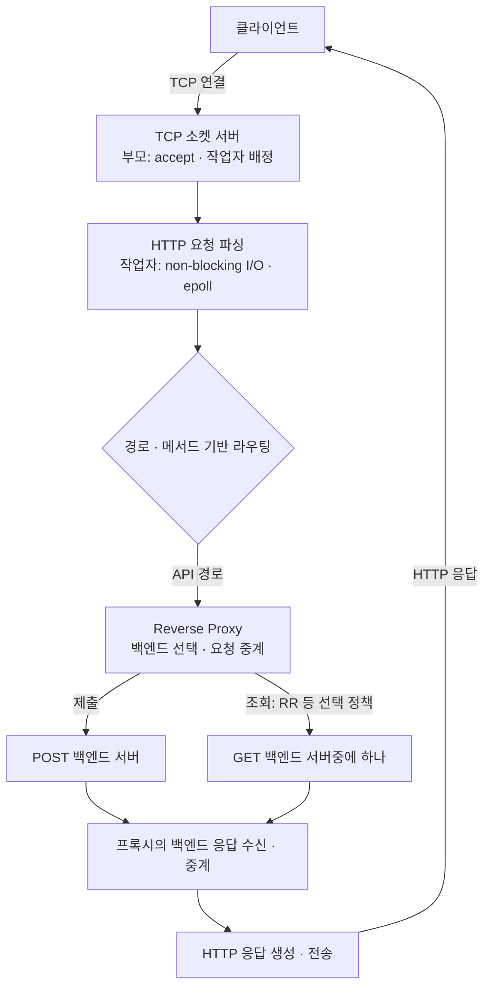
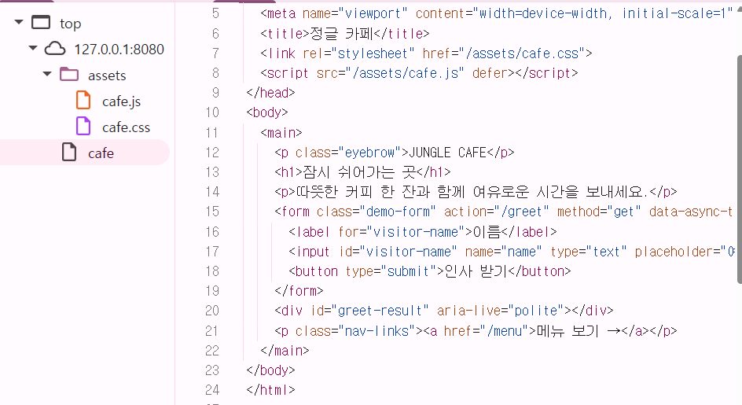
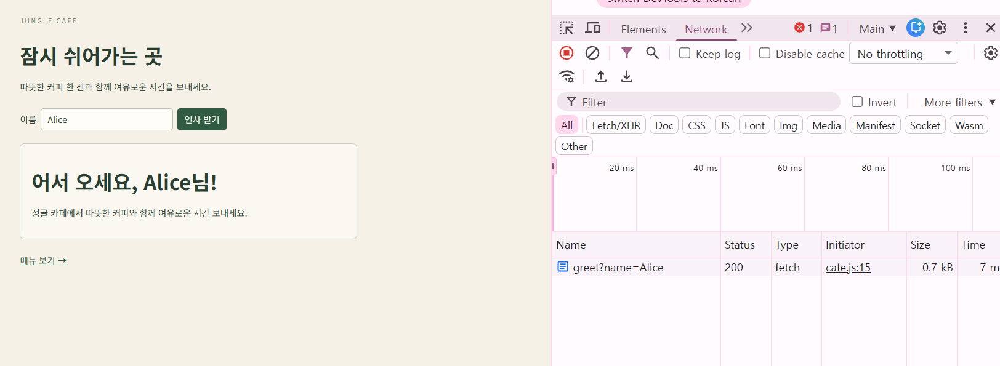
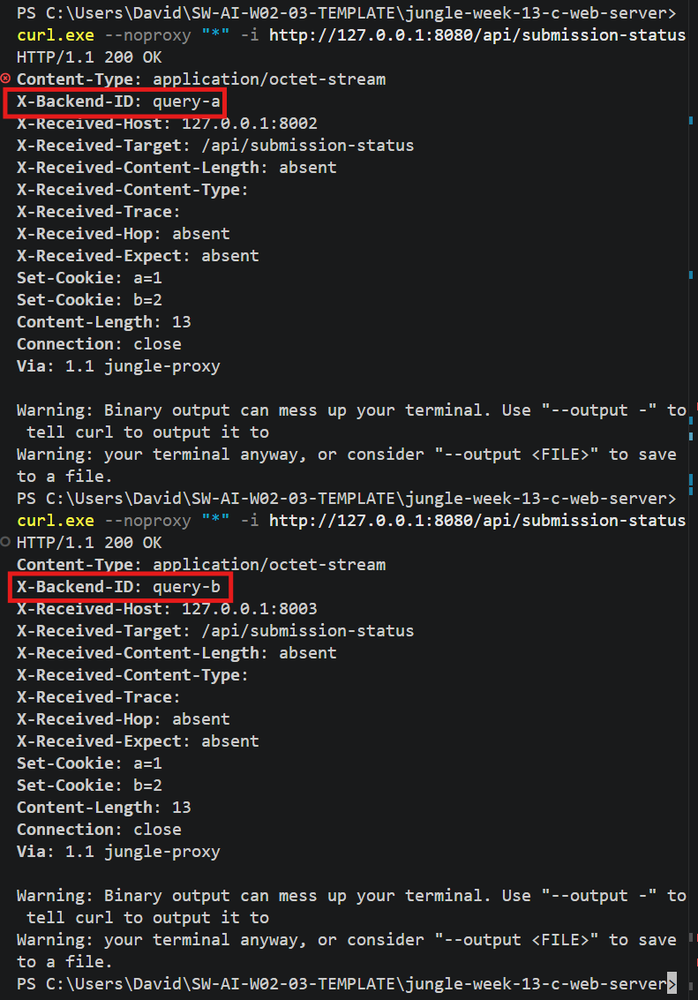
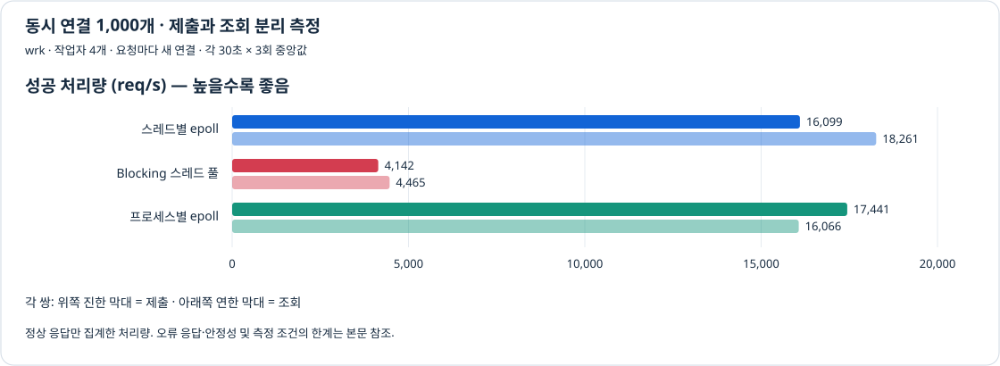

# C 웹 서버와 Reverse Proxy

> 기준: main의 구조와 2026-11-26까지 기록된 Iteration 5 비교 결과 · [발표 대본](presentation.md)

## 1. 프로젝트 소개

- **문제 배경**: 여러 요청이 몰릴 때 느린 클라이언트나 백엔드를 기다리는 동안 다른 요청도 지연될 수 있음.
- **결과**: C와 소켓 API로 웹 서버와 Reverse Proxy를 직접 구현하고, 요청을 여러 백엔드로 분배하며 여러 연결을 함께 처리하도록 구성.

## 2. 전체 아키텍처



- **그림 기준**: 기능별 요청 흐름. 부모·작업자와 내부 처리 기능은 하나의 웹 서버 구성.

**① 동시성 구조와 요청 처리 (TCP 소켓 서버 · HTTP 요청 파싱 · 동시 요청 처리)**

- **TCP 연결**: 부모가 연결 수락 → 작업자 배정. 설정 파일의 `worker-policy`로 배정 정책 지정.
- **HTTP 요청 파싱**: 메서드·경로·헤더 해석, 바이트 스트림에서 헤더·본문 경계 판단.
- **Blocking**: 읽을 데이터·송신 공간이 없으면 호출한 스레드 대기.
- **현재 동시성 모델**: `fork()` 기반 고정 프로세스 풀 + **non-blocking 소켓 + epoll 이벤트 루프**. 처리 불가 시 즉시 반환해 다른 준비된 연결 진행, 처리할 일이 없으면 epoll 대기.

**② 정적 파일 서빙 · 동적 요청 처리**

- **정적 파일 서빙**: 백엔드 전달 없이 웹 서버가 직접 제공. HTML 페이지와 CSS·JavaScript·이미지 파일 라우트.
- **동적 요청 처리**: 입력에 따른 응답 생성 또는 **CGI 프로그램 실행** 라우트.
- **파일 I/O**: 작업자별 **보조 스레드**에 위임.

**③ Reverse Proxy · 경로 기반 라우팅 · 로드 밸런싱**

- **역할 차이**: Forward Proxy는 **클라이언트**를, Reverse Proxy는 **백엔드 서버**를 대신해 요청 수신.
- **선택 이유**: 내부 서버 라우팅·부하 분산에 집중. 조회 분산과 느린 백엔드 대기 중 다른 요청의 진행 여부 검증.
- **Forward Proxy 확장 비용**: 절대 URL·호스트 해석, DNS 조회·대기 처리, 접속 대상 제한의 구현·검증 추가. 같은 동시성 구조로 구현 가능하나 현재 검증 완료 후 검토할 후순위 확장 항목.
- **경로 기반 라우팅**: POST 제출 요청 처리 백엔드 또는 GET 조회 요청 처리 백엔드 중 한 곳으로 전달.
- **중계**: 백엔드와 별도 TCP 연결, 백엔드 응답 수신 후 클라이언트에 전달.
- **정책 설정**: `worker-policy`는 작업자 배정, `query-policy`는 조회 백엔드 선택. 시작 시 읽고 각각 독립 지정.
- **네 선택 정책**: Round-Robin(`rr`), 미완료 수(`least-outstanding`), 응답 시간(`response-time`), 미완료 수·응답 시간 결합(`combined`).
- **미완료 수 기준**: 작업자는 미종료 연결 수, 백엔드는 진행 요청 수.

**④ HTTP 응답 생성**

- **로컬 응답**: 상태 코드·헤더·본문 구성 후 전송.
- **프록시 응답**: 백엔드 상태·본문 전달, 연결별 헤더 등 처리. 웹 서버 작업자 내부의 Reverse Proxy 기능.


## 3. 카페 데모

- **정적 페이지**: `/cafe` 호출 → HTML·CSS·JavaScript 서빙.



- **동적 응답**: 이름 `Alice` 입력 → ‘인사 받기’ → `/greet` 응답 반영.



- **프록시 중계**: 조회 API 두 번 호출 → RR 설정에서 `X-Backend-ID`로 조회 A/B 분산 확인.



## 4. 동시성 설계와 모델 비교

### 세 동시성 모델 성능 비교

- **모델**: 프로세스별 epoll, 스레드별 epoll, blocking 스레드 풀.
- **조건**: 동일 WSL2 노트북·작업자 4개·wrk, 제출과 조회 각각 **동시 연결 1,000개 × 30초 × 3회**. 요청마다 새 연결을 사용하며 제출 본문은 1KiB입니다. 프록시·순차 C 백엔드·부하 생성기는 같은 호스트에서 실행했습니다.
- **관측 결과**: 프로세스별 epoll의 성공 처리량은 제출 **17,441 req/s**, 조회 **16,066 req/s**였습니다. 스레드별 epoll의 조회 성공 처리량은 **18,261 req/s**였지만, 고부하의 504 응답도 함께 관측됐습니다.



- **선택 모델**: 프로세스별 epoll. 처리량과 함께 작업자 장애 격리·공유 상태 복구를 고려.
- **장애 대응 근거**: 작업자 일부 종료 후 나머지 작업자의 서비스 지속 확인. commit·rollback 공유 상태 복구는 별도 원장 단위 장애 주입으로 검증.

<details>
<summary>상세 결과 · 안정성 · 비교 한계</summary>

| 모델 | 제출 성공 req/s | 제출 p95 ms | 조회 성공 req/s | 조회 p95 ms |
| --- | ---: | ---: | ---: | ---: |
| 스레드별 epoll | 16,099 | 941.92 | 18,261 | 909.85 |
| blocking 스레드 풀 | 4,142 | 285.17 | 4,465 | 90.65 |
| 프로세스별 epoll | 17,441 | 68.19 | 16,066 | 72.36 |

- **오류 응답**: 성공 처리량과 별도 집계.

| 모델 | 제출 / 조회 오류 HTTP 응답: 3회 합계 |
| --- | --- |
| 스레드별 epoll | 504: 73,304 / 57,894건 |
| blocking 스레드 풀 | 408: 12 / 23건, 별도로 read·timeout 소켓 오류 관측 |
| 프로세스별 epoll | 504: 1,160 / 582건 |

- **지표 해석**: 성공 처리량은 검증된 정상 응답만 집계. p95는 성공·오류를 포함한 완료 HTTP 응답 기준, 미완료 요청 제외.
- **정합성**: 해당 시험의 정상 응답에서 본문·백엔드 ID 불일치 0건. 종료 시 미완료 건수 미계측으로 전체 실패율 확정 불가.

- **공통 안정성 시험**: 세 원본 커밋 모두 거절 502·무응답 504, 백엔드 복구 후 정상 제출, RST 30회 후 정상 응답, SIGTERM 종료 확인.
- **FD 전후**: 스레드 epoll 15→15, blocking 풀 6→6, 프로세스 epoll 42→42.
- **작업자 강제 종료**: 프로세스 모델의 작업자 2개를 차례로 종료한 뒤에도 남은 작업자로 정상 응답.

- **공유 상태 복구**: 별도 원장 단위 장애 주입에서 commit 확인 → 미완료 변경 rollback·완료 변경 보존 검증. 부모는 사망한 작업자의 남은 예약 회수.
- **작업자 수**: 공통 안정성 시험에서 4→3→2. 공유 상태 복구와 작업자 재생성은 별개이며 자동 재생성 미지원.

- **회귀 결과**: 원본 세 모델 `make test` 통과. `make verify`는 두 스레드 모델 통과, 프로세스 모델은 truncate 기대 200·실제 502 차이로 실패. Figure의 작업본에도 동일 실패 잔존.
- **검증 범위**: 별도 안정성 시험은 원본 커밋 기준. Figure 작업본의 전체 안정성 통과를 의미하지 않음.

- **조건 차이**: 프로세스 모델은 헤더 MSG_PEEK 수신 개선 작업본. 스레드 모델은 /tmp, 해당 작업본은 /mnt/c 실행. 측정 순서·큐·연결 상한 차이로 실행 모델만의 효과 분리 불가. 소스 식별·조건은 원본 보고서 참조.

- [제출·조회 분리 측정 보고서](docs/iteration-5/status-benchmark-20261126/README.md) · [원본 결과 JSON](docs/iteration-5/status-benchmark-20261126/results.json)
- [개선 전 세 모델의 혼합 부하·안정성 보고서](docs/iteration-5/comparison-wrk-20261126/wrk-comparison-report.md)
- [Figure 생성 스크립트](scripts/figure_iter5_comparison.py): 저장된 1,000 연결 결과만 읽어 생성하며 부하를 실행하지 않습니다.

</details>

## 5. 한계와 후속 검증

- **고부하 오류**: 504 발생 원인 구분과 프로세스 모델의 truncate 회귀 실패 해결 필요.
- **튜닝·지속성**: 작업자 수·버퍼·상한 변경 비교, 장시간·과부하 회복 검증 미완료.
- **공통 장애 검증 범위**: 잠금 단계별 사망·재복구, 작업자 사망 중 CGI 후손 정리 미포함. 별도 원장 단위 검증과 구분.
- **전체 통합 회귀**: 현재 main의 Iteration 5 전체 회귀·광범위 장애 주입은 최소 통합 확인과 구분해 추가 확인 필요.
- **1만 연결**: 검토 목표이며 실측·검증 미완료.
- **이식성**: Linux 전용 `epoll` 사용. macOS는 별도 대응 필요.

---

## 실행 준비

- **실행 위치**: 프로젝트 루트의 WSL 터미널.
- **준비 구성**: 카페는 웹 서버, API 시연은 백엔드 3개 추가 실행.

```sh
make all backend
./build/server 8080 config/proxy.conf.example
```

- **백엔드 실행**: 각각 별도 터미널 사용.

```sh
./build/test_backend 8001 submission
./build/test_backend 8002 query-a
./build/test_backend 8003 query-b
```

- **브라우저**: `http://127.0.0.1:8080/cafe`

```sh
curl --noproxy '*' -i http://127.0.0.1:8080/api/submission-status
curl --noproxy '*' -i http://127.0.0.1:8080/api/submission-status
```

- **사전 확인**: RR 설정·백엔드 기동. 이번 문서 편집에서 데모 재실행 없음.
- **시간 조절**: 브라우저 시연 지연 시 API 시연 생략, 구조도로 설명.

## 근거와 발표 시 주의점

- [프로젝트 실행·라우팅 설명](README.md), [카페 화면](public/pages/cafe.html), [카페 동작](public/assets/cafe.js).
- [프로세스 모델 통합 확인](docs/iteration-5/Snoopykid/iteration-5-cgi-main-review.md), [선택과 대안](docs/iteration-5/Snoopykid/iteration-5-design-decisions-collected.md).
- [스레드 이벤트 루프 후보 검증](docs/iteration-5/jaeseong/iteration-5-results.md). 해당 브랜치의 환경·권한 skip을 확인할 것.
- 비교 대상은 프로세스별 epoll, 스레드별 epoll, blocking 스레드 풀입니다. 소스 식별 정보는 원본 측정 보고서를 참고합니다.
- Iteration 4의 성능 수치와 다른 브랜치의 개별 측정치를 세 모델의 공정한 비교 결과로 사용하지 않는다. 현재 작성자는 새 부하 테스트를 실행하지 않았다.
- 조사 범위: 프로젝트의 접근 가능한 대화 목록과 구현 대화의 최근 비교 상태, 현재 main 문서·카페 파일, 로컬에 저장된 관련 브랜치 참조와 Iteration 5 결과 문서를 확인했다. 모든 브랜치의 모든 파일과 외부에만 있는 대화까지 전수 확인한 것은 아니다.
