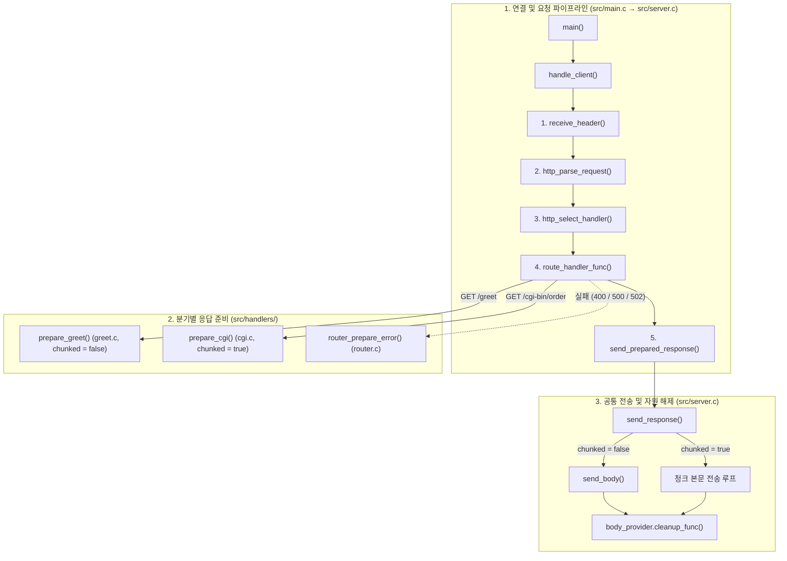

# Iteration 3 동적 서빙 설계 결정

상태: 확정 (구현·검증 전). 이 문서는 [iteration-3-dynamic-requirements.md](iteration-3-dynamic-requirements.md)의 요구사항을 만족하기 위한 **모듈 책임 경계, 자료구조·수명 설계, 트레이드오프와 근거**를 기록한다.

## 기존 표면과 변경 영향 요약

| 모듈 | 역할 및 변경 방향 |
|---|---|
| [src/http.h](../../../src/http.h), [src/http.c](../../../src/http.c) | `struct http_request`에 `query` 슬라이스 추가(`parse_start_line()`에서 `?` 분리), `http_reason()`에 `502` 추가 |
| [src/router.h](../../../src/router.h) | `struct router_response`에 `bool chunked` 추가 (기본 `false`로 기존 고정 길이 계약 보존) |
| [src/server.c](../../../src/server.c) | `open_listenfd()`/`handle_client()` 소켓 `FD_CLOEXEC` 설정, `send_response()` 청크 헤더 분기 및 청크 본문 송신 경로 추가 |
| [src/router.c](../../../src/router.c), [src/handlers/handlers.h](../../../src/handlers/handlers.h) | `routes[]`에 `GET /greet`, `GET /cgi-bin/` 등록, 공용 제공자(`router_prepare_borrowed_memory()`, `router_prepare_owned_memory()`)·경로 경계 헬퍼(`router_path_error_status()`, `router_inside_directory()`) 제공 |
| [src/handlers/basic.c](../../../src/handlers/basic.c), [static.c](../../../src/handlers/static.c), [greet.c](../../../src/handlers/greet.c), [cgi.c](../../../src/handlers/cgi.c) | 기본(`/`, `/hello`, `/echo`)·정적(`/cafe`, `/menu`, `/assets/`)·내부 동적(`/greet`)·외부 CGI(`/cgi-bin/...`) 핸들러 역할별 분리 |
| [public/assets/cafe.js](../../../public/assets/cafe.js), [cafe.html](../../../public/pages/cafe.html), [menu.html](../../../public/pages/menu.html) | 정적 JS `fetch()` + `DOMParser` 점진적 향상 연결 |

---

## 주요 설계 결정 및 근거

### D1. `struct http_request`의 `query` 슬라이스 분리 (파싱 vs 해석 분리)

- **결정**: [src/http.h](../../../src/http.h)의 `struct http_request`에 `struct http_slice query;`를 추가하고, [src/http.c](../../../src/http.c)의 `parse_start_line()`이 `?`를 기준으로 `path`와 원시 `query` 슬라이스를 함께 분리한다(`target` 메모리를 빌리므로 추가 할당 없음). 단, `&`/`=` 분리나 퍼센트 디코딩은 HTTP 파서가 수행하지 않는다.
- **트레이드오프 및 근거**:
  - `router.c`가 `request->target`과 `request->path.length`의 차이에 암묵적으로 의존하지 않고 명시적인 `request->query`를 사용할 수 있다.
  - HTTP 문법(`origin-form = absolute-path [ "?" query ]`)에 대칭적이며, 추후 Reverse Proxy(Iteration 4)가 쿼리를 해석하지 않고 그대로 보존·재사용하기 쉽다.

### D2. 라우팅과 URL 인코딩 정책의 핸들러 분리

- **결정**: `select_rule()`은 디코딩하지 않은 원본 `request->path`만 비교하고, 인코딩 정책은 각 핸들러가 담당한다.
- **근거**:
  - 정적·CGI 경로(`/assets/...`, `/cgi-bin/...`)의 `%` 차단은 파일 시스템 경로 혼선 방지용이며, 동적 Query의 `%XX` 디코딩 허용과 위험 모델이 다르다.
  - 파서·라우터 전역에서 인코딩을 미리 풀거나 차단하면 Iteration 4 Reverse Proxy에서 백엔드로 원본 경로를 넘길 때 충돌한다.

### D3. Query 파싱 계층과 도메인 검증의 책임 분리

- **결정**: Query 파싱 헬퍼는 표준 규칙(`&`·첫 `=` 선분리 → key/value 모두 `+`→`' '` 및 `%XX` 디코딩)에 따라 존재 여부와 디코딩된 바이트만 추출하며, 공통 C 문자열 안전성을 해치는 `%00`(NUL)만 전 파라미터에 대해 `400`으로 차단한다. 일반 제어 문자(`0x01`~`0x1F`, `0x7F`) 검증, 공백 trim, fallback(`"손님"`)은 `/greet` 핸들러가 담당한다.
- **근거**:
  - 디코딩 전 `&`·첫 `=`를 먼저 나눠야 `%26`, `%3D`가 구분자로 오인되지 않고 `name=a=b`도 보존된다.
  - `%00`을 파서 헬퍼에서 공통 차단하면 C 문자열 잘림 버그를 구조적으로 막을 수 있고, 일반 제어 문자·fallback 규칙은 엔드포인트별 도메인 요구에 따라 독립적으로 바꿀 수 있다.

### D4. 동적 HTML 응답 버퍼 수명 (`malloc` + `body_provider.cleanup_func`)

- **결정**: `/greet` HTML 응답은 HTML 이스케이프(최대 6배 확장)를 반영한 정확한 크기를 계산해 `malloc`으로 생성하고, `body_provider.next_func`·`body_provider.cleanup_func`를 통해 [src/server.c](../../../src/server.c)의 `send_prepared_response()`가 전송 성공·실패·조기 종료 모든 경로에서 `free()`하도록 소유권을 넘긴다.
- **근거**:
  - 정적 리터럴·`request->body`를 빌리는 기존 `prepare_memory_provider()`(`cleanup_func = NULL`)와 `file_body` 계약이 이미 `send_prepared_response()`에 통합되어 있으므로, 전송 계층을 수정하지 않고도 동적 버퍼 수명을 안전하게 관리할 수 있다.
  - 고정 크기 버퍼를 쓰지 않으므로 `REQ_HEADER_MAX_BYTES` 이내의 어떤 입력도 버퍼 부족 없이 처리된다.

### D5. `Transfer-Encoding: chunked` 전송 계약 확장

- **결정**: [src/router.h](../../../src/router.h)의 `struct router_response`에 `bool chunked;`를 두고, `chunked == true`이면 `send_response()`가 `Content-Length` 대신 `Transfer-Encoding: chunked`를 출력한 뒤 청크 본문 송신 루프를 실행한다. `BODY_DATA`의 `data == NULL` 또는 `length == 0`, `BODY_ERROR`, 송신 실패 시 `0\r\n\r\n`을 보내지 않고 중단하며 `send_prepared_response()`가 `cleanup_func` 1회 호출 및 `errno` 보존을 보장한다.
- **근거**:
  - `chunked == false`가 기본값이라 기존 고정 길이 응답과 [test_body_send.c](../../../tests/unit/test_body_send.c) 계약이 깨지지 않는다.
  - 비정상 중단 시 `0\r\n\r\n`을 생략해 수신자가 불완전 스트림을 감지할 수 있다.

### D6. CGI 프로세스 실행·헤더 버퍼링·좀비 회수 설계

- **결정**:
  1. **FD 상속 차단**: `open_listenfd()` 및 `handle_client()` 진입(또는 `accept()`)에서 소켓 FD에 `FD_CLOEXEC`를 설정한다.
  2. **파이프 EOF 보장**: `pipe()` + `fork()` 직후 부모는 파이프 쓰기 끝을 즉시 닫고, 자식은 `SIGPIPE`를 `SIG_DFL` 복원, `/dev/null` → `STDIN_FILENO`, 파이프 쓰기 끝 → `STDOUT_FILENO` 연결 후 최소 `envp`로 `execve()`한다(실패 시 `_exit(127)`).
  3. **헤더 선파싱 + 잔여 본문 보관**: 클라이언트 헤더 송신 전 `poll()`(5초 deadline)로 파이프에서 `\r\n\r\n` 또는 `\n\n`까지 읽어 `Content-Type`과 선택적 `Status:`만 취하고(프레이밍 헤더 무시), 같은 `read()`에 동반 도착한 본문 앞부분은 상태 버퍼에 저장해 첫 번째 `next_func()` 호출에서 먼저 반환한다.
  4. **종료 검증 & 좀비 회수**: `read() == 0`(EOF) 시 `waitpid()`로 `WIFEXITED && WEXITSTATUS == 0`을 확인해야만 `BODY_END`를 반환한다. 조기 종료·타임아웃 등으로 `cleanup_func`가 먼저 불려 자식이 미회수 상태면 `kill(pid, SIGTERM)` 후 `waitpid()`로 회수한다.
- **근거**:
  - 부모가 쓰기 끝을 닫아야 커널이 자식 `stdout` 종료를 정확한 EOF로 알리며, `FD_CLOEXEC`가 있어야 자식이 부모 소켓을 붙잡지 않는다.
  - 헤더 파싱과 초기 본문 보관을 분리해야 소켓에 헤더를 내보내기 전 실패 시 깔끔히 `502`로 전환할 수 있고, 첫 읽기에서 본문이 유실되지 않는다.

### D7. 정적 JS `fetch()` + `DOMParser` 점진적 향상

- **결정**: [public/assets/cafe.js](../../../public/assets/cafe.js)가 `<form>`의 `submit` 이벤트를 가로채 `fetch()`로 `/greet?...` 또는 `/cgi-bin/order?...` 완전한 HTML 응답을 받아 `DOMParser`로 결과 영역만 추출해 화면에 반영한다.
- **근거**:
  - 서버를 JSON API로 바꾸지 않고 HTML 계약을 유지하므로 직접 URL 접속·`curl`·JS 비활성 폼 제출·브라우저 비동기 UI 갱신을 모두 만족하며, 정적 `.js`(`text/javascript`) 서빙도 데모에 활용된다.

---

## 탑다운 Function Flow (Structure)

### 1. 전체 요청 흐름 (Level 0 → Level 1)



### 2. 계층별 하위 역할 구조 (Level 2 → Level 3)

#### A. 파싱 · 라우팅 ([src/http.c](../../../src/http.c), [src/router.c](../../../src/router.c))
```text
http_parse_request()
└─ parse_start_line()          # target → path + query 슬라이스 분리

http_select_handler()
└─ select_rule()
   ├─ GET /greet     (EXACT)   → 내부 동적 환영 핸들러
   └─ GET /cgi-bin/  (PREFIX)  → 외부 CGI 핸들러
```

#### B. 내부 동적 핸들러 (`GET /greet`, [src/handlers/greet.c](../../../src/handlers/greet.c))
```text
prepare_greet() (chunked = false)
├─ extract_query_name()        # & / 첫 '=' 분리, key·value 디코딩, 전체 %00 차단(400), 첫 "name"
├─ has_control_char() / trim   # 0x01~0x1F, 0x7F 차단(400) → 앞뒤 ' ' trim → 빈 값이면 "손님" fallback
├─ build_greet_html()          # &, <, >, ", ' 이스케이프 길이 계산 + malloc + 복사 (실패 시 500)
└─ router_prepare_owned_memory() # text/html; charset=utf-8, Content-Length 확정
```

#### C. 외부 CGI 핸들러 (`GET /cgi-bin/...`, [src/handlers/cgi.c](../../../src/handlers/cgi.c))
```text
prepare_cgi() (chunked = true)
├─ resolve_cgi_script()        # '%' 거부(400), 단일 depth / realpath / S_ISREG + X_OK (404)
├─ spawn_cgi_process()         # pipe + fork + SIGPIPE 복원 + dup2 + execve (부모 write end 즉시 close)
├─ read_cgi_header()           # poll(5s) 헤더(\r\n\r\n or \n\n) 파싱 + 잔여 본문 보관 (실패 시 502)
└─ cgi_body provider           # Status / Content-Type 설정, 미종료 시 자식 정리
```

#### D. 응답 전송 · 정리 (`send_prepared_response()`, [src/server.c](../../../src/server.c))
```text
send_prepared_response()
├─ send_response()
│  ├─ send_body()              # [chunked = false] 고정 길이 전송
│  └─ 청크 본문 전송 루프      # [chunked = true]  잔여 본문 → poll(5s)+read() → EOF 시 waitpid() 확인
└─ body_provider.cleanup_func()
   ├─ 소유 메모리 정리         # malloc 버퍼 free()
   └─ CGI 자원 정리            # pipe close(), 미회수 자식 kill(SIGTERM)+waitpid(), free()
```
