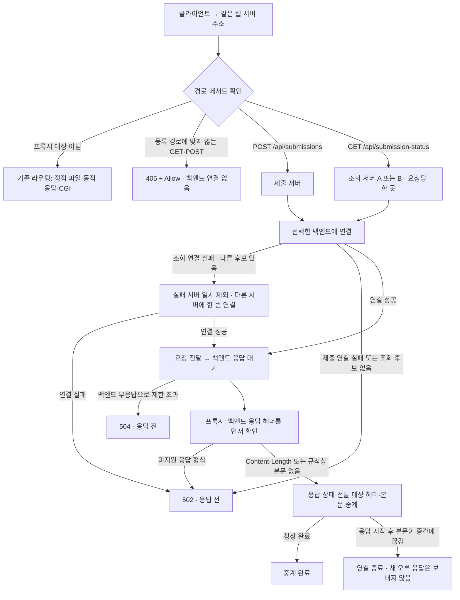

# Iteration 4 Reverse Proxy 요구사항

상태: 확정·구현 완료. 이 문서는 `chan95821`의 개인 구현에서 관찰할 수 있는 동작과 범위를 기록한다. 합의한 항목은 본문에, 미구현·후속 범위는 설계 문서와 마지막 절에 남긴다. 팀 공통 기준은 [Issue #4](https://github.com/chan95821/jungle-week-13-c-web-server/issues/4)와 [Issue #17](https://github.com/chan95821/jungle-week-13-c-web-server/issues/17)을 따른다. 이 문서는 두 이슈를 대체하거나 수정하지 않는다.

## 논의 진행표

구역을 바꿀 때마다 **방금 확정한 것 → 아직 남긴 것 → 다음 구역과 그곳에서 결정할 것**을 먼저 알린다. 서로 다른 구역의 결정을 섞지 않으며, 권장 기본값은 별도 승인 항목으로 올리지 않는다.

| 구역 | 현재 상태 |
| --- | --- |
| 1. 시나리오·라우팅 | 확정: 기존 데모 유지, 정확한 경로·메서드 매칭, 제출·조회 목적지 분리 |
| 2. 공통 헤더 처리·전송 | 주요 결정 확정: 보존·제거·재작성, 헤더만으로 가능한 조기 거부, 출력 헤더 구성, 클라이언트 송신 책임 |
| 3. 백엔드 대기·장애 처리 | 정책 확정: 최종 헤더까지 총 대기 제한, 본문 중계 중 무진행 제한. 구체적인 시간은 검증 기본값으로 남김 |
| 4. 조회 로드밸런싱 | 정책 확정: 정상 시 라운드 로빈, 조회 연결 실패 시 한 번 우회·일시 제외·요청 기반 복귀 |
| 5. 개인 검증 | 단위·E2E 기준 확정: 정상 분산, 종료·복구, 설정 파일, 모의 백엔드 [검증 기준](iteration-4-tests.md) |

## 1. 시나리오

과제 마감 직전, 학생들이 한 주소에서 과제를 제출하고 제출 상태를 조회한다. 제출은 전용 백엔드 한 곳이 받고, 조회는 같은 역할을 맡는 조회 서버 A·B에 나눠 보낸다. 각 조회 요청은 두 서버 중 한 곳에서만 처리한다. A·B는 같은 고정 상태를 반환하며, 어느 서버가 처리했는지 식별자로 구분한다.

같은 웹 서버의 **기존 정글 카페 데모는 계속 직접 서빙**한다. 즉, 기존 서버를 프록시로 교체하지 않고 기존 서빙에 프록시 역할을 추가한다. 과제 제출 시나리오는 별도 화면을 만들지 않고 HTTP 요청과 응답으로 확인한다.

### 요청부터 응답까지

그림은 과제 제출 시나리오의 흐름을 보여준다. `/api/hello` 완료 조건은 별도로 유지하며, 지원하지 않는 클라이언트 요청의 오류 정책은 아직 확정하지 않았다.

## 2. 라우팅과 역할 경계

과제 제출 시나리오의 프록시 라우트 매칭 기준:

| 경로 | 메서드 |
| --- | --- |
| `/api/submissions` | `POST` |
| `/api/submission-status` | `GET` |

- 제출 요청은 제출 서버에만 전달하고 본문을 바이트 단위로 보존한다. 조회 요청은 A·B 중 한 곳에만 전달하며, 정상 조회 요청 묶음에서는 두 서버가 모두 사용된다.
- 개인 구현의 조회 기본 정책은 선택 가능한 A·B 사이의 라운드 로빈이다. 조회 서버의 연결에 실패해 요청을 아직 보내지 않았다면 그 서버를 일시 제외하고, 선택 가능한 다른 서버로 같은 조회를 한 번만 우회한다. 선택 가능한 서버가 없거나 두 번째 연결도 실패하면 `502`를 반환한다.
- 제외 시간이 지난 뒤 실제 조회에서 해당 서버 순서가 오면 연결을 다시 시도한다. 연결에 성공하면 라운드 로빈에 복귀하고, 다시 실패하면 재차 제외한다. 별도의 heartbeat나 주기적 상태 확인은 하지 않는다.
- 우회는 조회 서버 연결 실패에만 적용하는 개인 확장이다. 백엔드에 요청 송신을 시작한 뒤에는 재시도하지 않으며, 느린 응답이나 `5xx`만으로 서버를 제외하지 않는다. 제출 경로의 장애 처리는 그대로 유지한다. 팀 공통 범위는 [Issue #17](https://github.com/chan95821/jungle-week-13-c-web-server/issues/17)을 따른다.
- 등록 경로에 허용되지 않은 GET·POST가 오면 백엔드에 전달하지 않고, `405`와 해당 라우트의 허용 메서드를 담은 `Allow`를 반환한다.
- `/cafe`, `/menu`, `/greet`, `/cgi-bin/order`, `/assets/...` 등 기존 경로의 정적·동적 서빙과 CGI 동작은 유지한다.
- 경로는 쿼리를 제외한 **디코딩하지 않은 원본 경로**로 정확히 비교한다. 백엔드로 보낼 때 경로를 재작성하지 않고 쿼리도 원본 그대로 전달한다.
- `/api/submissions/extra`처럼 등록된 프록시 경로와 일치하지 않는 요청은 백엔드로 보내지 않고 기존 라우팅 규칙에 맡긴다.
- 라우트는 **목적지**를 정하고, 프록시는 **메시지의 경계를 판단하고 중계**한다. 같은 메시지 형식을 쓰는 백엔드를 추가할 때 중계 규칙이 특정 제출·조회 경로에 묶이지 않아야 한다.
- [Issue #4](https://github.com/chan95821/jungle-week-13-c-web-server/issues/4)의 `/api/hello` 완료 조건도 유지한다. 이 경로는 서비스 API가 아니라 **부모 이슈가 정한 중계 확인용 더미**이며, 전용 핸들러 `prepare_hello_proxy()`가 이번 구성의 단일 백엔드(제출 서버)로 전달한다. 위 표는 과제 제출 시나리오의 계약이고 `/api/hello`가 이를 대체하지 않는다.

### 실행 설정

- 백엔드 주소는 설정 파일로 받는다: `./build/server <port> [routes.conf]`. 파일을 주지 않으면 내장 기본값(제출 `8001`, 조회 `8002`·`8003`)을 쓴다.
- 형식은 `submit <host>:<port>` 정확히 한 줄과 `lookup <host>:<port>` 한 줄 이상이다. 빈 줄과 `#` 주석 줄은 무시하고, IPv6는 `[::1]:8002`처럼 쓴다. 예시는 [config/routes.conf.example](../../../config/routes.conf.example)에 둔다.
- 주소는 숫자 IPv4·IPv6만 허용한다. DNS 이름, 잘못된 포트, 중복 `submit`, `submit`/`lookup` 누락, 최대 8개 초과 `lookup`, 알 수 없는 키는 서버를 시작하지 않고 종료한다. 설정 오류로 기존 설정을 부분 적용하지 않는다.
- 정적 파일 루트는 이번 Iteration에서 기존처럼 `public` 고정을 유지한다.

### 합의한 설계 경계: 두 연결의 송신 책임

- `http_select_handler()`는 경로·메서드로 핸들러를 선택할 뿐, 어느 쪽으로도 송신하지 않는다.
- `handle_client()`가 호출하는 프록시 핸들러는 **백엔드에 요청을 송신**하고, 응답 헤더를 검증한 뒤 클라이언트에 보낼 응답과 `body_provider`를 준비한다.
- **클라이언트 응답 송신**은 기존 `send_prepared_response()` 흐름이 맡는다. 본문은 `body_provider`를 통해 조금씩 읽어 중계한다. 응답 준비 중 실패하면 프록시 핸들러가 백엔드 연결을 정리하며, 연결을 `body_provider`에 넘긴 뒤에는 기존 송신 흐름이 성공·실패 모두에서 공급자의 정리 함수를 호출한다.

### 합의한 설계 경계: 헤더 파싱과 전달 정책

- `http_parse_request()`는 검증한 요청 헤더의 이름과 값을 프록시 핸들러가 사용할 수 있게 제공한다. 현재 `parse_connection()`이 남기는 `close`·`keep-alive` 플래그만으로는 `Connection`이 지정한 다른 헤더를 식별할 수 없다. 기존 정적·동적·CGI 핸들러의 헤더 처리 정책은 유지한다.
- 어떤 헤더를 보존·제거·재작성할지는 프록시가 결정한다. 요청과 응답 모두에서 `Connection`의 모든 값을 먼저 확인하고, 다음 연결로 전달할 때 `Connection` 자체와 거기에 이름이 지정된 헤더를 제거한다. 헤더 이름의 대소문자나 등장 순서는 결과에 영향을 주지 않는다. 근거: [RFC 9110 §7.6.1](https://www.rfc-editor.org/rfc/rfc9110.html#section-7.6.1).
- 백엔드로 보내는 HTTP/1.1 요청에는 검증한 원본 `Host` 값을 유지하며, 선택한 백엔드의 내부 주소·포트로 바꾸지 않는다. TCP 연결 대상은 경로·메서드와 조회 분산 규칙으로만 결정하며, `Host` 값을 연결 대상으로 사용하지 않는다. 형식 검증은 해당 이름을 신뢰하거나 공개 서비스 이름으로 승인했다는 뜻이 아니다.
- `Connection`이 요청의 `Host` 또는 요청·응답의 `Content-Length`나 `Transfer-Encoding`을 지목하면, 해당 헤더를 유지하는 예외를 두지 않고 메시지 자체를 중계하지 않는다. 클라이언트 요청이면 백엔드에 보내지 않고 `400`, 백엔드 응답이면 클라이언트에 최종 응답을 시작하기 전에 `502`를 반환한다. 이는 이번 구현의 오류 정책이다.
- 요청 헤더 파싱과 프록시 라우트 매칭을 통과한 뒤, 헤더만으로 중계 불가를 판단할 수 있으면 `handle_client()`에서 `100 Continue`를 보내거나 본문을 더 읽기 전에 거부한다. 백엔드에는 연결하지 않는다. 기존 파서의 오류 정책과 프록시 대상이 아닌 경로의 처리 순서는 유지한다.
- 수신 헤더 전체를 별도로 보관하거나 제자리에서 편집하지 않는다. 수신 버퍼가 유효한 동안 검증된 이름·값을 참조해, 다음 연결에 필요한 헤더만 새로 구성한다. 전달 대상의 값은 보존하되 원래 줄의 공백이나 표기까지 보존하지는 않는다.
- 요청·응답 모두 다음 연결에 보낼 시작 줄과 헤더를 상한이 있는 출력 버퍼에 빈 줄까지 완성한 뒤 전송한다. 헤더 작성 실패 시 일부만 보내지 않는다. 본문은 출력 헤더 버퍼에 넣지 않고 별도로 전송하며, 백엔드 응답 본문은 기존 `body_provider` 흐름으로 중계한다.
- 검증 예: `X-Demo`가 `Connection: close, x-demo`보다 앞에 있어도 백엔드에는 전달되지 않는다. `Connection`에 지정되지 않은 `Content-Type`은 보존된다.

## 3. 중계와 메시지 길이

- 현재 요청 본문은 `handle_client()`가 기존 상한 내에서 전부 수신한 뒤 프록시 핸들러에 전달한다. 큰 업로드·동시 요청의 메모리 사용·전달 시작 지연이 요구나 측정으로 문제가 되면 요청 스트리밍 또는 임시 파일 버퍼링을 검토한다. 이번 단계에서 본문 수신 계약은 변경하지 않는다.
- 백엔드 요청의 헤더와 본문 송신에는 하나의 총시간 제한을 적용한다. 헤더 송신 완료나 부분 송신으로 제한을 다시 시작하지 않는다. 송신 중 연결 장애는 `502`, 시간 초과는 `504`, 내부 오류는 `500`으로 처리하고 다른 백엔드에 재시도하지 않는다.

- 제출 요청은 `Content-Length`로 본문 길이를 명시하고, 조회 요청은 본문 없이 보낸다. 본문이 있는 최종 백엔드 응답도 `Content-Length`로 길이를 명시한다. `204`처럼 HTTP 규칙상 본문이 없는 응답에는 길이 헤더를 요구하지 않는다.
- 응답 길이는 **라우팅 시점이 아니라 백엔드 응답 헤더를 받은 뒤** 확인한다. 전체 본문이 도착하기를 기다릴 필요는 없지만, 선언된 길이에 도달하기 전에 연결이 끊기면 완료된 응답으로 취급하지 않는다.
- 백엔드의 응답 상태, 전달 대상 헤더, 본문 바이트를 보존한다. `Connection`과 이 헤더가 지정한 연결별 헤더, 프록시가 다시 작성하는 `Content-Length`·`Content-Type`은 원본을 그대로 넘기지 않는다. 나머지 일반 헤더는 원본 순서와 다중 줄을 유지해 전달한다.
- 프록시는 `chunked` 본문과 연결 종료로 끝을 표시하는 응답 본문을 지원하지 않는다. 지원하지 않는 형식을 빈 본문이나 정상 응답으로 간주하지 않는다. 기존 CGI가 직접 생성하는 `chunked` 응답은 유지한다.
- 이번 구현에서는 위 응답 형식을 기준으로 고정한다. 형식이 지원 범위 안이라면 백엔드가 반환한 `404`나 `500`도 그대로 중계하며, 본문의 의미는 검사하지 않는다. 본문이 허용되는 최종 응답의 길이를 지원하는 방식으로 판별할 수 없다면, 클라이언트로 응답을 보내기 전에 `502`를 반환한다.
- 새로운 백엔드가 다른 응답 형식을 실제로 요구할 때 중계 범위를 확장한다. 그때도 라우트별로 응답 형식 예외를 두지 않고, 공통 중계 규칙에서 지원할 형식을 늘린다.

## 4. 장애 처리와 검증 기준

| 상황 | 기대 동작 |
| --- | --- |
| 백엔드 연결이 즉시 거절됨 | 제출은 `502` 반환. 조회는 가능한 다른 서버에 한 번만 우회하고, 다른 후보가 없거나 연결에 다시 실패하면 `502` 반환. |
| 백엔드 최종 응답의 본문 경계를 지원하는 방식으로 판별할 수 없음 | 응답 전송 전에 `502` 반환. |
| 백엔드에 요청을 모두 보낸 뒤 최종 응답 헤더를 완전히 받기 전에 총 대기 제한을 넘김 | `504` 반환. 일부 헤더 바이트나 중간 `1xx`를 받아도 제한을 다시 시작하지 않음. |
| 클라이언트로 응답을 보내기 시작한 뒤 백엔드 본문이 중간에 끊김 | 연결을 닫아 불완전한 응답임을 판별할 수 있게 하고, 새 오류 응답을 덧붙이지 않음. |
| 클라이언트로 최종 응답을 보내기 시작한 뒤 백엔드 본문을 기다리는 중 바이트 수신이 제한 시간 동안 진행되지 않음 | 연결을 닫고 새 오류 응답을 덧붙이지 않음. 본문 수신이 진행되면 무진행 제한을 다시 계산함. |
| 장애가 반복된 뒤 정상 요청을 보냄 | 정상 처리되며 연결 정리 후 열린 파일 디스크립터(FD) 수가 누적되지 않음. |

이번 구현에서는 백엔드 응답 전체에 별도의 총시간 상한을 두지 않는다. 제한 시간의 구체적인 값은 검증 기본값으로 정하고, Iteration 5에서 동시성을 도입한 뒤 제출 지연·실패율을 측정해 재조정할 수 있다.

검증에서는 목적지와 처리 서버 식별자, 제출 요청·바이너리 응답의 바이트 일치, 상태와 전달 대상 헤더, 장애 후 복구, 기존 서빙 회귀를 확인한다. 팀 공통 기준은 A·B의 정확한 분배 비율이나 교대 순서를 강제하지 않지만, 개인 구현에서는 선택한 라운드 로빈이 동작하는지 별도로 확인한다. **두 서버에 분산됐다는 사실만으로 처리량이 개선됐다고 판단하지 않는다.**

개인 검증에서는 정상 A·B와 B만 느린 조건을 비교한다. 요청 조건과 라운드 로빈 정책은 유지하고 조회와 제출의 지연·실패율을 관찰한다. 가능하면 같은 조건을 동시성 도입 뒤에도 다시 확인해, 느린 백엔드에 같은 비율로 전달한 영향과 프록시가 순차 처리하면서 다른 요청까지 대기시킨 영향을 구분한다.

조회 서버 종료·복구는 느린 B와 별도로 검증한다. B가 종료돼도 A가 정상이면 조회를 제공하고, 제외 시간 동안 B에 반복 연결하지 않으며, B를 재시작한 뒤 실제 조회로 분산이 복구되는지 확인한다.

느린 B의 병목이 재현되면 결과를 보고 추가 분배 로직을 검토한다. 평소에도 B의 처리 용량이 낮은 경우에는 가중 라운드 로빈을 후보로 둘 수 있다. 지연이나 부하에 따른 동적 분배는 이번 기본 구현에 포함하지 않는다.

## 5. 범위 밖

- 새 과제 제출 화면, 실제 과제 저장, 제출·조회 데이터의 실시간 동기화
- 주기적 헬스 체크, 제출 요청 우회, 백엔드 요청 송신을 시작한 뒤의 재시도
- Forward Proxy, HTTPS `CONNECT` 터널링
- 프록시의 `chunked` 및 연결 종료 기반 본문 중계, 이번 단계에서의 동시성 도입

## 6. 논의가 필요한 설계 결정

- **개인 검증 조건:** 정상 분산, 조회 서버 종료·복구, 느린 B의 요청 조건 및 관찰 방법을 테스트 문서에서 정한다. 구체적인 제외 시간은 검증 기본값으로 정한다. 느린 서버에 대한 추가 분배 로직은 검증 결과가 나온 뒤 검토한다.

### 별도 논의 없이 적용할 권장안

아래는 확정된 요구사항이 아니라 구현·검증을 시작할 때의 권장 기본값이다.

- 무응답 검증은 [Issue #17](https://github.com/chan95821/jungle-week-13-c-web-server/issues/17)의 초안에 맞춰 연결·요청 송신 제한 1초, 최종 응답 헤더 대기 3초로 시작한다. 본문 중계 중 바이트가 진행되지 않을 때의 무진행 제한은 1초를 유지한다.
- 제출 요청에 `Content-Length`가 없으면 `411`, 조회 요청이 양의 본문 길이를 선언하면 `400`을 반환한다. 미지원 요청 전송 형식은 기존 `http_parse_request()`의 판정을 재사용한다.
- 잘못된 백엔드 상태 줄·헤더·본문 길이 선언은 최종 응답 전에 `502`로 처리한다. `204`·`304`에는 본문을 보내지 않으며, `204`에는 `Content-Length`도 쓰지 않는다.
- `101` 업그레이드는 거부한다. 중간 `1xx`를 건너뛰고 최종 응답까지 계속 읽는 루프는 다음 단계로 미루며, 그 전에는 `1xx`를 최종 응답으로 중계하지 않고 `502`로 거부한다.
- 기존 클라이언트 요청 헤더 상한은 유지한다. 백엔드 응답의 수신 헤더 상한은 기존 `REQ_HEADER_MAX_BYTES`와 같은 8 KiB, 프록시 출력 헤더 상한은 16 KiB로 시작한다. 수신한 백엔드 헤더가 상한을 넘으면 `502`로 처리하며, 출력 작성이 실패하면 부분 헤더는 보내지 않는다.
- `Connection` 토큰뿐 아니라 다음 연결에서 재사용할 수 없는 연결별 헤더도 넘기지 않는다. 백엔드 요청에는 중계 식별용 `Via`를 추가하고, 값은 내부 주소 대신 고정 별칭을 사용한다. 근거: [RFC 9110 §7.6.1](https://www.rfc-editor.org/rfc/rfc9110.html#section-7.6.1), [§7.6.3](https://www.rfc-editor.org/rfc/rfc9110.html#section-7.6.3).

조회 분산 검증에 사용할 요청 수는 개인 테스트 문서에서 결정한다.
