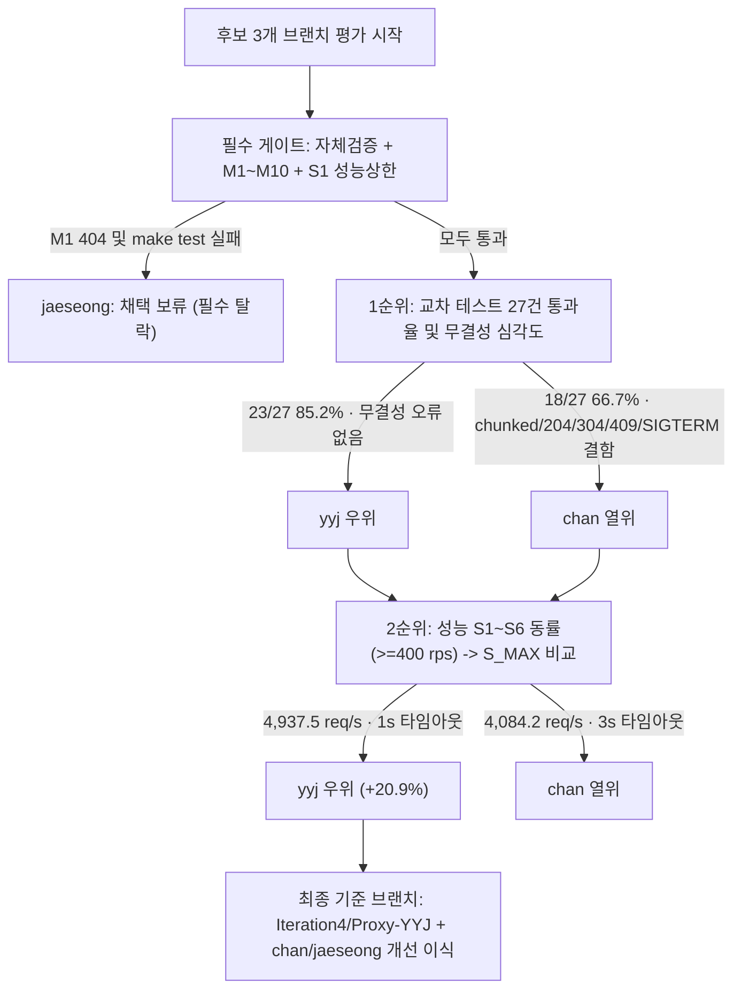
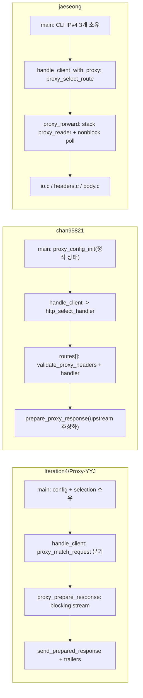

# Iteration 4 코드 보완 핸드오프 및 평가 보고서 (`Iteration4/Proxy-YYJ` 기준)

> **목적**: 이 문서는 대화 이력이 없는 다른 에이전트가 **`origin/Iteration4/Proxy-YYJ` (`f32e17d`)를 머지 기준 브랜치로 채택 확정**한 상태에서, 실제 머지 전후에 반영할 **코드 보완 사항을 검토·합의·구현**할 수 있도록 모든 맥락과 전체 비교 평가 보고서를 담은 단일 기준 문서다.
> **현재 작업 상태**: 아직 `main`에 머지하지 않았으며, 코드 수정 없이 핸드오프 문서만 작성한 상태다.

---

## Part A. 핸드오프 요약 및 작업 경계

### 1. 기준 브랜치와 참고 브랜치

모든 후보는 `main` (`0b34e68`)에서 분기했다.

| 역할 | 브랜치 | 커밋 | 평가 요약 |
| --- | --- | --- | --- |
| **기준 브랜치 (채택 확정)** | `origin/Iteration4/Proxy-YYJ` (이하 `yyj`) | `f32e17d` | 필수 게이트 `11/11` 통과, 교차 테스트 1위(`23/27`, `85.2%`), 최고 처리량(`S_MAX` `4,937.5 req/s`), 전역 가변 상태 없음 |
| **참고 브랜치 A** | `origin/chan95821` (이하 `chan`) | `eda192c` | 필수 게이트 `11/11` 통과, 교차 테스트 `18/27` (`66.7%`), `S_MAX` `4,084.2 req/s`. 라우팅·업스트림 추상화·IPv6/가변 설정·보안 사전검증 우수 |
| **참고 브랜치 B** | `origin/team/jaeseong/iteration-4-reverse-proxy-25` (이하 `jaeseong`) | `c177c23` | 필수 `M1_api_hello` 실패(`404`) 및 `c177c23` 회귀(`make test`·`make verify-proxy` 실패)로 머지 불가. `HTTP/1.0` 승격·`proxy/` 계층 분리·스택 `proxy_reader` 참고 가치 |

### 2. 반드시 지킬 프로젝트 제약 및 의사결정 규칙 ([AGENTS.md](../../AGENTS.md))

1. **기술 스택 제한**: C11 (`-std=c11 -Wall -Wextra -Werror`) + 표준 C 라이브러리 및 POSIX API만 사용한다. `libevent`, `libuv`, `nginx`, `Apache`, `mongoose` 등 외부 HTTP/이벤트 루프 라이브러리 사용 금지.
2. **범위 경계 (Iteration 4)**: Forward Proxy, HTTPS `CONNECT`, Iteration 5 동시성(멀티워커/이벤트 루프)을 앞당겨 구현하지 않는다.
3. **선(先) 합의 후(後) 구현**:
   - **외부 동작, 설계·책임 경계, 자원 소유권·수명, 안전·오류 정책, 트레이드오프**를 바꾸는 보완(특히 아래 **P0 항목 1~3** 및 **P1 타임아웃 변경**)은 코드를 작성하기 전에 **반드시 사용자에게 선택지와 차이를 설명하고 명시적 승인을 먼저 받는다**.
   - Issue #17 범위 밖 기능(예: `chan`의 단일 조회 서버 장애 2초 일시 제외·자동 우회)은 팀 합의 없이 기본 동작에 편입하지 않는다.
4. **검증 규칙**: 구현 후 `make clean && make all && make test`(ASan/UBSan)와 `make verify`(E2E 회귀)를 모두 통과해야 하며, 컴파일 확인과 기능·회귀 검증 결과를 구분해 보고한다.

### 3. 보완 중 반드시 보존해야 할 `yyj` 불변 조건 (Invariants)

`yyj` 코드를 보완할 때 아래 기존 장점이 훼손되지 않도록 유지한다.

- **필수 게이트 및 성능 상한**: `M1`~`M10` 및 `S1` 상한(제출 `p95 <= 500ms`, 실패 `0`, 조회 실패율 `<= 1%`, `5xx = 0`), `S_MAX` 포화 처리량 `~4,900+ req/s` 수준 유지.
- **응답 프레이밍 및 원문 무결성**: `src/proxy_transfer.c`의 `chunked` 응답(청크 확장·`body_provider.trailers` 트레일러 전달 포함), 길이 없는 EOF 응답의 `chunked` 재프레이밍, `1xx` 임시 응답 처리, `204`/`304` 본문 없음 규칙(`204` `Content-Type` 미합성, `304` `Content-Length` 보존), 비표준 상태 문구(`409 Conflict` 등) 보존, 응답 `Via: 1.1 jungle-proxy` 추가.
- **전역 가변 상태 0개 및 소유권 명확성**: `src/main.c`의 `g_running` 외 변경 가능한 전역 상태를 만들지 않고 `struct proxy_config`와 `struct proxy_selection_state`는 `main()` 지역 변수로 소유한다.
- **즉시 시그널 종료 및 FD 회수**: 모든 백엔드/클라이언트 I/O가 `struct io_context.running`을 검사해 `SIGTERM`/`SIGINT` 시 `0.00s` 내 정리 종료하며, 장애 반복·클라이언트 `RST` 후에도 열린 FD가 누적되지 않는다(`4 → 4`).

---

## Part B. 타 브랜치 기반 코드 보완 명세 (P0 / P1 / P2)

> 각 항목의 타 브랜치 원문은 아래 명령으로 즉시 확인할 수 있다.
> ```sh
> git show <브랜치>:<파일경로>
> ```

### [P0-1] 요청 방향 `Host` 헤더 원본 보존 (`C2` 실패 보완)

- **현재 문제 및 재현 증거**:
  - 교차 테스트 `C2_host_header_preserved`에서 `POST /api/submissions` (`Host: original.example`) 전송 시 백엔드가 수신한 `Host`가 `127.0.0.1:<port>`로 덮어써졌다.
  - 근거: `origin/Iteration4/Proxy-YYJ:src/proxy_transfer.c:139-179` (`forward_request_to_backend()`). `L156`에서 `"host"`를 건너뛰고 `L165-169`에서 `Host: %s:%u\r\n`을 백엔드 IP:포트로 새로 작성한다.
- **표준·설계 근거**:
  - Reverse Proxy가 원본 `Host`를 덮어쓰면 백엔드가 가상 호스트 분기, 절대 리다이렉트 `Location` 생성, 쿠키 도메인, 출처 검증을 수행할 수 없다(RFC 9110 §7.2).
  - 단, `yyj`가 의도적으로 백엔드 주소 `Host` 재작성을 선택한 것인지 팀 계약 확인이 필요하다.
- **수정 대상 (`yyj`)**:
  - `src/proxy_transfer.c`의 `forward_request_to_backend()` (`L144-169`):
    - `L156`의 `http_field_name_equal(field.name, "host")` 제거(일반 헤더 순회에서 원본 `Host`를 그대로 복사)하고, `L144, L146, L166-168`의 `inet_ntop` + `Host: %s:%u` 생성 제거.
    - **유지 범위**: `Connection` 지명 헤더 제거, `content-length`/`expect`/`trailer` 필터링, `Via: 1.1 jungle-proxy` 추가, `Connection: close` 강제는 그대로 유지한다.
- **타 브랜치 참고 구현**:
  - `origin/chan95821:src/proxy.c:363-367` (`should_skip_original_request_header()` — `Host`를 스킵 목록에서 제외하고 `Connection: Host`는 사전 검증으로 차단)
  - `origin/team/jaeseong/iteration-4-reverse-proxy-25:src/proxy/headers.c:105-109, 119-144` (`proxy_build_request_headers()` — `Host` 원본 줄 보존)
- **사용자 확인 필요 사항**:
  - *"Reverse Proxy가 백엔드로 전달할 때 클라이언트 원본 `Host`를 보존할지, 기존처럼 백엔드 `IP:port`로 재작성할지 결정"*
- **검증 기준**:
  - `tests/unit/` 및 `scripts/verify_iter4.py`에서 백엔드가 `Host: original.example`을 수신하는지 확인 (`yyj`의 `scripts/verify_iter4.py:427-428` 기대값도 결정에 맞춰 갱신).

---

### [P0-2] `Connection` 지명 보호 헤더 조기 `400` 거부 (`C3` 실패 보완)

- **현재 문제 및 재현 증거**:
  - 교차 테스트 `C3_connection_protected_header_400`에서 `POST /api/submissions`에 `Connection: Host` + `Expect: 100-continue` + `Content-Length: 10`을 보냈을 때, `yyj`는 `100 Continue`를 응답하고 본문을 읽어 백엔드까지 연결·전달했다(`early_100=True, status=201, backend_hits=1`).
  - 근거: `origin/Iteration4/Proxy-YYJ:src/proxy.c:63-89` (`proxy_match_request()`)는 경로·메서드만 판별하며 `Connection` 옵션을 검사하지 않고, `src/server.c:69-88` (`handle_client()`)이 `100 Continue` 이후 `forward_request_to_backend()`에서 뒤늦게 `Host`를 제거한다.
- **표준·오류 정책 근거**:
  - 클라이언트가 `Connection: Host`, `Connection: Content-Length`, `Connection: Transfer-Encoding`으로 HTTP/1.1 필수·프레이밍 보호 헤더 제거를 요청하면 모호한 중계/요청 밀수(smuggling) 위험이 있으므로 본문 수신 및 `100 Continue` 전에 `400 Bad Request`로 조기 거절하는 정책이 안전하다.
- **수정 대상 (`yyj`)**:
  - `src/proxy.c` (또는 별도 helper) 및 `src/proxy.h`: `chan`의 보호 필드 판정 함수 도입.
  - `src/proxy.c:63-89` (`proxy_match_request()`): 프록시 경로·메서드 매칭(`L87`) 이후, `proxy_route != PROXY_ROUTE_LOCAL`이면 보호 필드 검사(`400` 반환) 수행.
  - `src/server.c:69-72` (`handle_client()`): `proxy_match_request()`가 `0`이 아닌 `400`을 반환하면 `goto respond;`로 직행하므로 자동으로 `100 Continue`(`L82`)·본문 읽기(`L88`)·백엔드 연결(`L110`) 전에 차단된다. 기존 로컬 경로에는 영향 없음.
- **타 브랜치 참고 구현**:
  - `origin/chan95821:src/proxy_validation.c:8-39` (`connection_lists_header()`, `validate_proxy_headers()` — `{"Host", "Content-Length", "Transfer-Encoding"}` 검사)
  - `origin/chan95821:src/router.c:178-185` (`http_select_handler()`에서 `selected->validate_request(request)` 호출)
  - 단위 테스트 참고: `origin/chan95821:tests/unit/test_proxy_validation.c`
- **사용자 확인 필요 사항**:
  - *"프록시 경로에서 `Connection`이 `Host`/`Content-Length`/`Transfer-Encoding`을 지목할 때 조기 `400`으로 거절하는 정책을 채택할지 확인"*
- **검증 기준**:
  - `Connection: Host` + `Expect: 100-continue` 요청 시 `100 Continue` 미송신, 즉시 `400`, 백엔드 연결/도달 `0건`. 정상 `Connection: X-Hop`은 계속 `201` 통과.

---

### [P0-3] 1-인자 CLI (`./build/server <port>`) 하위호환 복원 (`C14` 실패 보완)

- **현재 문제 및 재현 증거**:
  - 교차 테스트 `C14_cli_compat_and_bad_config`에서 `./build/server <port>` 1-인자 실행이 즉시 종료(`1arg_local_ok=False`)되었다.
  - 근거: `origin/Iteration4/Proxy-YYJ:src/main.c:20-23`이 `if (argc != 3)`로 강제 종료한다. 이로 인해 `yyj` 브랜치에서는 기존 회귀 스크립트인 `scripts/verify_iter1.py`, `scripts/verify_iter3.py`, `scripts/verify_iter3_dynamic.py`까지 임시 설정을 붙이도록 수정해야 했다.
- **설계·이슈 근거**:
  - Iteration 1~3의 실행 계약(`./build/server <port>`)과 회귀 스크립트를 변경 없이 통과시키면서도 프록시 설정을 받을 수 있어야 한다.
- **수정 대상 (`yyj`)**:
  - `src/main.c:19-35`: `argc != 2 && argc != 3` 허용.
  - `src/server.h:20-23` & `src/server.c:218-221, 69-72, 110-114` (`handle_client()`): `proxy_config == NULL` 지원 여부(옵션 A) 또는 기본 설정 로드(옵션 B).
- **타 브랜치 참고 구현 (두 가지 선택지)**:
  - **선택지 A (`jaeseong` 방식 — 로컬 서빙 전용)**: `origin/team/jaeseong/iteration-4-reverse-proxy-25:src/main.c:35-48, 88-89` & `src/server.c:585` (`if (proxy) ...`). `argc == 2`일 때 프록시를 끄고 기존 정적·동적 서버로만 동작(`/api/*`는 `404`).
  - **선택지 B (`chan` 방식 — 내장 기본값 사용)**: `origin/chan95821:src/main.c:36-48` & `src/proxy_config.c:180-194` (`use_builtin_defaults()`). `argc == 2`일 때 기본 주소(`127.0.0.1:8001`, `8002`, `8003`)로 프록시까지 활성화.
- **사용자 확인 필요 사항**:
  - *"`./build/server <port>` 단독 실행 시 (A) 로컬 서빙 전용으로 둘지, (B) 기본 포트(`8001/8002/8003`) 프록시 설정을 적용할지 결정, 그리고 수정됐던 `verify_iter1/3/3_dynamic.py` 원복 여부 확정"*
- **검증 기준**:
  - 무인자·잘못된 인자·잘못된 설정 파일은 리스닝 전 `exit != 0`, `./build/server <port>`는 정상 기동 후 `GET /hello` `200 Hello` 반환, 기존 `verify_iter1/2/3/3_dynamic.py` 수정 없이 통과.

---

### [P1-4] 백엔드 `HTTP/1.0` 응답 수용 및 `HTTP/1.1` 승격 (`C7` 실패 보완)

- **현재 문제 및 재현 증거**:
  - 교차 테스트 `C7_http10_backend`에서 백엔드가 `HTTP/1.0 200 OK\r\nContent-Type: text/plain\r\nContent-Length: 5\r\n\r\nhello`를 반환했을 때, `yyj`는 `502 Bad Gateway`로 거절했다.
  - 근거: `origin/Iteration4/Proxy-YYJ:src/proxy_transfer.c:355` (`parse_backend_headers()`)가 `memcmp(line, "HTTP/1.1 ", 9) != 0`만 허용한다.
- **표준·참고 구현**:
  - RFC 9110/9112 상 레거시 백엔드 또는 `python3 -m http.server` 등 간이 백엔드는 `HTTP/1.0`으로 응답하는 경우가 흔하다. 특히 `yyj`는 EOF 응답을 `Transfer-Encoding: chunked`로 재프레이밍하므로, 클라이언트에 보낼 때는 `HTTP/1.1`로 승격해야 한다.
  - 참고: `origin/team/jaeseong/iteration-4-reverse-proxy-25:src/proxy/headers.c:179` (`memcmp(header, "HTTP/1.1 ", 9) != 0 && memcmp(header, "HTTP/1.0 ", 9) != 0`) 및 `L260-261` (`if (*output_length >= 8) output[7] = '1';`).
  - 참고 2: `origin/chan95821:src/http.c:348` (`parse_response_status_line()`도 `HTTP/1.1 `과 `HTTP/1.0 ` 모두 허용).
- **수정 대상 (`yyj`)**:
  - `src/proxy_transfer.c:355` (`parse_backend_headers()`): `HTTP/1.0 ` 허용.
  - `src/proxy_transfer.c:211-213` (`build_client_response_headers()`): 상태 줄을 출력 버퍼에 쓸 때 `"HTTP/1.1 "`로 버전 표기 정규화(`output[7] = '1'`).
  - 주의: `HTTP/1.0` 응답은 `Content-Length`가 없으면 `BACKEND_CLOSE`로 처리되어 `yyj`의 기존 `EOF → chunked` 재프레이밍 경로가 그대로 안전하게 작동한다.
- **검증 기준**:
  - 단위 테스트(`test_proxy_protocol.c`)에 `HTTP/1.0` 고정 길이·EOF-종료·`1xx` 예외(RFC 9112 상 `HTTP/1.0`에서는 `1xx` 비허용 또는 무시) 케이스 추가, E2E `C7` 통과 확인.

---

### [P1-5] 본문 무진행 타임아웃 통일 검토 (`M8` `5.18s` → `1.00s`)

- **현재 현황 및 근거**:
  - `origin/Iteration4/Proxy-YYJ:src/proxy.h:41-48`:
    - `PROXY_CONNECT_SECONDS = 1`, `PROXY_HEADER_SECONDS = 1`, `PROXY_REQUEST_SECONDS = 5`, `PROXY_BODY_IDLE_SECONDS = 5`, `PROXY_BODY_SECONDS = 15`.
  - 본문이 중간에 멈춘 `M8_mid_body_stall`에서 `chan`(`1.02s`)과 `jaeseong`(`1.00s`)은 1초 만에 정리한 반면 `yyj`는 `5.18s`가 소요되었다. 순차 서버에서 느린/멈춘 백엔드 1건이 전체 후속 요청을 5초간 막는 원인이 된다.
- **수정·확인 사항**:
  - 사용자에게 `PROXY_REQUEST_SECONDS` (`5s → 1s`?) 및 `PROXY_BODY_IDLE_SECONDS` (`5s → 1s`?)를 Issue #17의 1초 제한 초안에 맞춰 통일할지 확인 후 상수 및 단위/E2E 기대 시간 조정.

---

### [P1-6] 세부 HTTP/1.1 준수 정밀도 2건 보강

1. **본문 없는 요청(`GET`)에 `Content-Length: 0` 생략 검토**:
   - 현재 `yyj` `src/proxy_transfer.c:166`은 `GET /api/submission-status`에도 무조건 `Content-Length: 0`을 붙인다.
   - `chan` (`origin/chan95821:src/proxy.c:409-414`)처럼 `if (request->has_content_length)`일 때만 `Content-Length`를 전송하면 RFC 9110 §8.6 관례("`GET`에는 `Content-Length`를 생성하지 않아야 한다")에 더 부합한다. (`POST`는 `request->has_content_length` 또는 `request->body.length == 0` 분기 확인 — `chan`은 `POST`에 CL 누락 시 처리를 별도 고려해야 하므로 `POST`일 때는 항상 `Content-Length`를 쓰되 `GET`에 `has_content_length == false`면 생략하는 방식이 가장 안전함.)
2. **`1xx` 임시 응답(`102..199`)에 `Connection: close` 미첨부**:
   - 현재 `yyj` `src/proxy_transfer.c:200-201`에서 `100 < status < 200`일 때 `build_client_response_headers(stream)`을 호출하는데, 이 함수 끝(`L235-236`)이 `Connection: close\r\nVia: 1.1 jungle-proxy\r\n\r\n`을 무조건 붙인다.
   - HTTP/1.1에서 `1xx` 임시 응답 뒤에는 최종 응답이 이어지므로 `Connection: close`를 `1xx` 블록에 붙이는 것은 어색하다(`L235`를 `if (stream->status >= 200)` 조건으로 감싸 `1xx`에는 `Via` 또는 빈 줄만 붙이도록 보완 권장).

---

### [P1-7] 에지 케이스 테스트 스위트 흡수

- `origin/chan95821:scripts/verify_edge_cases.py` (34종 에지 프로브: 불완전 헤더 `400`/`408`, 8KiB URI `404`/`431`, 64KiB/65537B/10MiB `413` 조기 거절 및 스트리밍 차단, 부분 헤더/느린 본문/중간 중단) + 이번 평가의 교차 반례(`C2`, `C3`, `C7`, `C12`, `C13`, `C14`)를 `yyj`의 검증 체계(`make verify-edge` 등)에 통합한다.

---

### [P2-8] `proxy_stream` 49.4 KiB 메모리 경량화 및 `proxy_transfer.c` 분리 (Iteration #5 대비)

- **현재 구조적 한계**:
  - `yyj` `src/proxy_transfer.c:18-42`의 `struct proxy_stream`은 한 연결당 `buffer[16384] + raw_header[8192] + client_header[16640] + trailer_buffer[8192] ≈ 49,408 bytes` (~49.4 KiB)를 `calloc`으로 상시 점유한다.
  - 10,000 동시 연결(Iteration #5 목표) 시 프록시 스트림 버퍼만 **약 494 MB**를 소비하며, 본문 스트리밍 단계로 넘어간 뒤에는 `raw_header`와 `client_header`가 더 이상 필요 없는데도 끝까지 메모리에 남는다.
  - 또한 `src/proxy_transfer.c` 한 파일에 576줄(연결 + 요청 송신 + 응답 헤더 파싱 + 본문 스트리밍 + 청크/트레일러 파싱)이 몰려 있다.
- **타 브랜치 참고 구조**:
  - `origin/team/jaeseong/iteration-4-reverse-proxy-25`:
    - 파일 분리: `src/proxy.c` (조율) + `src/proxy/internal.h` + `src/proxy/io.c` (181줄) + `src/proxy/headers.c` (308줄) + `src/proxy/body.c` (212줄).
    - 수명 분리: 응답 헤더 수신/재구성용 임시 버퍼(`8 KiB`)는 헤더 단계에서만 사용하고, 본문 중계 단계는 `struct proxy_reader` (`buffer[8192]`)만 유지.
- **주의할 점 (Iteration #5 설계 선택)**:
  - Iteration 4의 `yyj`는 `router_response` + `body_provider` 인터페이스를 통해 `send_prepared_response()`로 송신한다. Iteration #5에서 non-blocking 이벤트 루프로 전환할 때 `body_provider`를 상태 머신으로 바꿀지, `jaeseong`처럼 `proxy_transfer`가 양방향 소켓 상태를 직접 구동할지는 #5 설계 단계에서 결정한다. 단, Iteration 4 통합 단계에서도 `raw_header`를 `receive_backend_response_headers()` 지역 버퍼로 내리거나 `client_header`·`trailer_buffer`를 동적 크기/유연 배열로 분리하면 즉시 연결당 상주 메모리를 50% 이상 줄일 수 있다.

---

### [P2-9] 라우팅 일원화 · 가변 백엔드(IPv6/N대) · 선택 정책 콜백 분리 (Iteration #6 대비)

- **현재 `yyj` 한계**:
  - `src/proxy.c:63-100`: `/api/submissions`, `/api/submission-status`, `/api/hello`가 `router.c`의 `routes[]` 밖에서 별도 `if/else`로 분기되며, `struct proxy_config`가 `query_backends[2]` 고정 크기 배열(`src/proxy.h:18`)이고 IPv4만 지원한다.
- **타 브랜치 참고 구조 (`chan95821`)**:
  - `origin/chan95821:src/router.c:100-185`: `struct route_rule` 테이블에 `validate_request` 훅을 두어 정적·동적·CGI·프록시 경로를 단일 테이블로 관리.
  - `origin/chan95821:src/proxy.h:9-29`: `struct proxy_upstream` (`backends`, `backend_count`, `select_backend`, `on_connection_result`, `group_state`)로 연결/중계와 로드밸런싱 정책 분리.
  - `origin/chan95821:src/proxy_config.c:66-101` & `src/proxy_connect.c:62-79`: 숫자 IPv4 + `[IPv6]:port` 및 `sockaddr_storage` 지원, `lookup` 최대 8대 설정.
- **반드시 지켜야 할 경계**:
  - **`chan`의 정적 전역 상태 안티패턴(`src/proxy_config.c:26-39` `lookup_group`)은 가져오지 않는다.** `yyj`처럼 `proxy_config`와 선택/정책 상태(`proxy_selection_state`)를 `main()`이 소유하고 인자로 전달하는 소유권 모델을 유지해야 #5 멀티워커 확장에 유리하다.

---

### [P2-10] 타 브랜치에서 절대 가져오지 말아야 할 결함 (Do-Not-Port 목록)

| 출처 | 파일·심볼 | 결함 내용 | 교차 테스트 증거 |
| --- | --- | --- | --- |
| `jaeseong` | `src/proxy.c:91-111` (`c177c23`) | `proxy_select_route()`가 `+405`/`+501`을 반환해 `server.c`의 음수 오류 체크를 통과, 오등록 메서드가 백엔드로 중계됨 | `make test` 실패, `C1` 실패 |
| `jaeseong` | `src/proxy/io.c:137-159` (`proxy_reader_fill()`) | 매 `recv()` 호출마다 `started_at + 1000ms`를 새로 잡아 slow-drip 헤더에 무기한 대기 | `C12` 실패 (`4.00s → 200`) |
| `jaeseong` | `src/proxy.c:115-122` / `router.c` | `/api/hello` 라우트 미등록 | `M1` 실패 (`404`) |
| `chan` | `src/proxy.c:17` | `BACKEND_RESPONSE_HEADER_TIMEOUT_MS = 3000` (Issue #17의 1초 제한 초안 초과, 3s HoL 유발) | `M6b` 실패 (`2.5s → 200`) |
| `chan` | `src/proxy.c:154,176,242` / `src/proxy_connect.c:83` | `io_context.running == NULL` 전달로 `SIGTERM` 수신 후 백엔드 타임아웃까지 대기 | `C13` 실패 (`2.97s` 지연) |
| `chan` | `src/server.c:164,170` / `src/http.c:472` | `204`에 `Content-Type` 강제 합성, `304`의 `Content-Length` 삭제, `http_reason()`으로 비표준 상태 문구 덮어씀 | `C9`, `C10` 실패 |
| `chan` | `src/proxy_selection.c` (`C15`) | 2초 일시 제외 + 실패 시 우회 로직을 팀 합의 없이 기본 동작으로 넣지 말 것 (Issue #17 범위 외) | `C15` 참고 |

---

## Part C. 종합 평가 보고서 (전체 근거 데이터)

### C.1 평가 기준과 판정 흐름

Issue #4와 Issue #17의 채택 순서(**필수 → 교차 테스트 통과율·심각도 → 성능 → 단순함과 #5 변경 범위**)에 따라 검증했다.



### C.2 자체 빌드·테스트 검증 결과

세 브랜치 모두 원형 그대로(`git archive`, 코드 무수정) 격리 빌드 및 자체 검증을 실행했다.

| 항목 | `yyj` (`f32e17d`) | `chan` (`eda192c`) | `jaeseong` (`c177c23`) |
| --- | --- | --- | --- |
| `make clean && make all` | ✅ `rc=0` (`build/server`, `cgi-bin/order`) | ✅ `rc=0` (`build/server`, `cgi-bin/order`) | ✅ `rc=0` (`build/server`, `cgi-bin/order`) |
| `make test` (ASan/UBSan) | ✅ `rc=0` (`7/7` 통과) | ✅ `rc=0` (`19/19` 통과) | ❌ **`rc=2` (`test_proxy.c:24` assertion fail)** |
| `make verify` | ✅ `rc=0` (Iter 1~4 통과; 단 기존 `verify_iter1/3/3_dynamic.py`를 2-arg용으로 수정함) | ✅ `rc=0` (Iter 1~4 통과, 기존 스크립트 무수정) | ⚠️ `verify` `rc=0` (Iter 1~3만 포함), **`make verify-proxy` `rc=2` (`verify_iter4.py:311` 실패)** |
| 추가 자체 검증 | C 테스트 백엔드 `build/test_backend` 포함 | `make verify-edge` `rc=0` (`34/34` 통과) | — |

### C.3 통합 교차 테스트 집합 통과표 (28종)

#### Group A — 필수 게이트 (`M1`~`M10`, 11건)

| ID | 검증 항목 | 심각도 | `yyj` | `chan` | `jaeseong` | 관측 요약 |
| --- | --- | --- | --- | --- | --- | --- |
| `M1_api_hello` | `GET /api/hello` 백엔드 중계 (#4) | 무결성 | ✅ | ✅ | ❌ | `jaeseong`: `404`, 백엔드 도달 0 |
| `M2_submit_binary_post` | `POST /api/submissions` 16KiB 바이너리 분할 전송·쿼리·`Set-Cookie` | 무결성 | ✅ | ✅ | ✅ | 3후보 모두 `201`, `hits=(1,0,0)` |
| `M3_query_distribution` | `GET /api/submission-status` 10건 A/B 분산 | 무결성 | ✅ | ✅ | ✅ | 3후보 모두 `sub=0, qa=5, qb=5` |
| `M4_hop_by_hop_both_ways` | 양방향 hop-by-hop·`Connection` 지명·`Expect: 100-continue` 처리 | 무결성 | ✅ | ✅ | ✅ | `100 Continue` 프록시 종료 및 양방향 제거 |
| `M5_refused_502` | 미리스닝 포트 연결 거절 시 `502` | 오류코드 | ✅ | ✅ | ✅ | 제출·조회 모두 `502` |
| `M6a_silent_3s_then_close` | 3.15s 무응답 시 `504` | 오류코드 | ✅ (`1.05s`) | ✅ (`3.00s`) | ✅ (`1.00s`) | 모두 `504` |
| `M6c_silent_4s_then_close` | 4.0s 무응답 시 `504` | 오류코드 | ✅ (`1.02s`) | ✅ (`3.00s`) | ✅ (`1.00s`) | 모두 `504` |
| `M7_mid_body_truncate` | 응답 본문 중간 끊김 시 새 오류 미첨부·`IncompleteRead` 판별 | 무결성 | ✅ | ✅ | ✅ | 상태 줄 1회 + 불완전 감지 |
| `M8_mid_body_stall` | 응답 본문 중간 정지 시 새 오류 미첨부·타임아웃 종료 | 무결성 | ✅ (`5.18s`) | ✅ (`1.02s`) | ✅ (`1.00s`) | `yyj`는 `BODY_IDLE=5s` |
| `M9_fault_recovery_and_fd_leak` | 장애·RST 10회 반복 후 정상 복구 및 FD 누적 0 | 무결성 | ✅ (`4→4`) | ✅ (`4→4`) | ✅ (`4→4`) | FD 누수 없음 |
| `M10_local_regression_with_proxy_on` | 프록시 활성 시 정적·동적·CGI·404 회귀 | 무결성 | ✅ | ✅ | ✅ | 모두 통과, 백엔드 도달 0 |
| **필수 소계** | | | **11 / 11** | **11 / 11** | **10 / 11 (탈락)** | |

#### Group B — 교차 반례 테스트 (`M6b`, `C1`~`C16`, 채점 16건 + 관측 1건)

| ID | 반례 항목 | 심각도 | `yyj` | `chan` | `jaeseong` | 관측 요약 |
| --- | --- | --- | --- | --- | --- | --- |
| `M6b_silent_2_5s_then_200` | 2.5s 무응답 후 200 (Issue #17 1초 제한 초안) | 오류코드 | ✅ (`504@1.02s`) | ❌ (`200@2.50s`) | ✅ (`504@1.00s`) | `chan` 3s 헤더 타임아웃 |
| `C1_wrong_method_405_501` | 오등록 메서드 `405+Allow` / `501` | 오류코드 | ✅ | ✅ | ❌ | `jaeseong` 백엔드에 3건 모두 전달(`201/200/201`) |
| `C2_host_header_preserved` | 요청 `Host` 원본 보존 | 무결성 | ❌ | ✅ | ✅ | `yyj` `Host: 127.0.0.1:<port>`로 덮어씀 |
| `C3_connection_protected_header_400` | `Connection: Host` 조기 `400` (`100 Continue` 전) | 오류코드 | ❌ (`201`) | ✅ (`400`, 조기) | ❌ (`early_100→400`) | `chan`만 본문/100 전 차단 |
| `C4_chunked_backend_response` | 백엔드 `chunked` 응답(확장·바이너리·트레일러) | 무결성 | ✅ (트레일러 보존) | ❌ (`502`) | ✅ (트레일러 미전달) | `yyj`만 `X-Trailer`까지 전달 |
| `C5_chunked_truncated_and_bad` | `chunked` 조기 종료·오류 크기 시 종료청크 생략 | 무결성 | ✅ | ❌ (`502`) | ✅ | `chan` chunked 미지원 |
| `C6_eof_delimited_backend` | 길이 없는 EOF 응답 → `chunked` 재프레이밍 | 무결성 | ✅ | ❌ (`502`) | ✅ | `chan` CL 필수 정책 |
| `C7_http10_backend` | 백엔드 `HTTP/1.0` 응답 중계 | 무결성 | ❌ (`502`) | ✅ | ✅ | `yyj` `HTTP/1.1`만 허용 |
| `C8_interim_1xx_then_200` | `103 Early Hints` 이후 최종 `200` 중계 | 무결성 | ✅ (103 전달) | ❌ (`502`) | ✅ (103 소비) | `chan` `1xx` 미지원 |
| `C9_no_body_204_304` | `204` 무헤더 유지 및 `304` `Content-Length` 보존 | 무결성 | ✅ | ❌ | ✅ | `chan` 204 CT 합성 / 304 CL 누락 |
| `C10_custom_status_409` | `409 Conflict` 비표준 reason phrase 보존 | 무결성 | ✅ (`Conflict`) | ❌ (`Internal Server Error`) | ✅ (`Conflict`) | `chan` `http_reason()` 덮어씀 |
| `C11_malformed_backend_502` | 중복 CL, CL+TE, 204+CL, 101, folded, 잘못된 Connection | 오류코드 | ✅ | ✅ | ✅ | 모두 `502` |
| `C12_slow_drip_header_timeout` | 0.4s 간격 저속 헤더 드립(총 4s) 차단 | 오류코드 | ✅ (`504@1.00s`) | ✅ (`504@3.00s`) | ❌ (`200@4.00s`) | `jaeseong` per-recv 타이머 리셋 |
| `C13_sigterm_during_backend_wait` | 백엔드 무응답 대기 중 `SIGTERM` 즉시 종료 | 무결성 | ✅ (`0.00s`) | ❌ (`2.97s`) | ✅ (`0.00s`) | `chan` `running == NULL` |
| `C14_cli_compat_and_bad_config` | 1-인자 `./build/server <port>` 호환 + 불량 설정 거절 | 오류코드 | ❌ (`1-arg` 거부) | ✅ | ✅ | `yyj` 2-인자 필수 |
| `C16_via_header_both_ways` | 요청·응답 양방향 `Via` 헤더 추가 | 무결성 | ✅ | ❌ (요청만) | ✅ | `chan` 응답 `Via` 미구현 |
| `C15_single_query_down_observation` | *(관측 전용, 채점 제외)* 조회 B 중단 시 4회 조회 | 참고 | `[200,502,200,502]` | `[200,200,200,200]` | `[200,502,200,502]` | `chan` 우회 확장 기능 |
| **총 채점 통과율 (27건)** | | | **23 / 27 (85.2%)** | **18 / 27 (66.7%)** | **23 / 27 (85.2%, M1 탈락)** | |

### C.4 공정 성능 벤치마크 결과 (Go 백엔드 3대 + Go 부하 생성기)

- **측정 환경**: `nproc = 16`, Kernel `Linux 7.3.5-2-cachyos-bore`, `loadavg_start = 1.13 1.32 1.15`, `loadavg_end = 1.57 1.39 1.27`, `ip_local_port_range = 32768-60999`.
- **백엔드 및 부하 조건**: Go `net/http` 기반 백엔드 3대(`submit` 201 1KB, `query-a` 200 1KB, `query-b` 200 1KB, 인위 지연 `0ms`), Go 부하 생성기 2프로세스 동시 실행(`DisableKeepAlives=true`, 요청 타임아웃 `5s`, `2xx`만 p50/p95 집계). 한 번에 1개 프록시만 기동해 조건별 3회 중앙값과 변동폭(min–max)을 측정했다.
- **직접 백엔드 기준선 (`direct_baseline`)**:
  - `S1_direct` (제출 `2 rps` + 조회 `10 rps`): 제출 p95 **`1.099 ms`** (`0.883–1.113`), 조회 p95 **`1.008 ms`** (`0.961–1.102`).
  - `S5_direct` (제출 `2 rps` + 조회 `200 rps`): 제출 p95 **`0.671 ms`** (`0.663–0.737`), 조회 p95 **`0.642 ms`** (`0.628–0.669`).

| 단계 | 측정 항목 (3회 중앙값) | `yyj` (`Proxy-YYJ`) | `chan` (`chan95821`) | `jaeseong` |
| --- | --- | --- | --- | --- |
| **S1** (게이트, `3×20s`) | 제출 p95 (min–max) / 실패 / 5xx | `1.750 ms` (1.581–1.760) / `0/120` / `0` | `1.729 ms` (1.646–2.096) / `0/120` / `0` | `1.671 ms` (1.365–1.693) / `0/120` / `0` |
| 제출 `2 rps`, 조회 `10 rps` | 조회 RPS / 조회 p95 / 실패율 | `10.0` / `1.653 ms` / `0%` | `10.0` / `1.658 ms` / `0%` | `10.0` / `1.489 ms` / `0%` |
| Direct 대비 추가 지연 | 제출 / 조회 (p95) | `+0.651` / `+0.645 ms` | `+0.630` / `+0.650 ms` | `+0.572` / `+0.481 ms` |
| **S2** (조회 `25 rps`, `3×8s`) | 제출 p95 / 조회 p95 / 실패 | `1.901` / `1.621 ms` / `0%` | `1.533` / `1.650 ms` / `0%` | `1.496` / `1.588 ms` / `0%` |
| **S3** (조회 `50 rps`, `3×8s`) | 제출 p95 / 조회 p95 / 실패 | `1.519` / `1.415 ms` / `0%` | `1.695` / `1.465 ms` / `0%` | `1.608` / `1.421 ms` / `0%` |
| **S4** (조회 `100 rps`, `3×8s`) | 제출 p95 / 조회 p95 / 실패 | `1.370` / `1.082 ms` / `0%` | `1.207` / `1.116 ms` / `0%` | `1.389` / `1.119 ms` / `0%` |
| **S5** (조회 `200 rps`, `3×8s`) | 제출 p95 / 조회 p95 / 실패 | `0.952` / `0.841 ms` / `0%` | `1.173` / `0.871 ms` / `0%` | `1.169` / `0.841 ms` / `0%` |
| Direct 대비 추가 지연 | 제출 / 조회 (p95) | `+0.281` / `+0.199 ms` | `+0.502` / `+0.229 ms` | `+0.498` / `+0.199 ms` |
| **S6** (조회 `400 rps`, `3×8s`) | 제출 p95 / 조회 p95 / 실패 | `0.861` / `0.680 ms` / `0%` | `0.816` / `0.721 ms` / `0%` | `0.905` / `0.683 ms` / `0%` |
| **S_MAX** (무제한 `-c 16`, `3×5s`) | **조회 처리량 (req/s, min–max)** | **🥇 `4,937.5`** (`4,926–4,945`) | `4,084.2` (`3,593–4,376`) | `4,815.8` (`4,719–4,845`) |
| | 포화 시 제출 p95 / 조회 p95 / 실패 | `3.661` / `3.636 ms` / `0%` | `4.304` / `4.517 ms` / `0%` | `3.600` / `3.699 ms` / `0%` |
| **A/B 분산 합계** | `query-a` / `query-b` | `56,552 / 56,552` | `48,456 / 48,456` | `55,237 / 55,237` |
| **프록시 FD 변화** | `fd_before → fd_after` | `4 → 4` | `4 → 4` | `4 → 4` |

**지연 주입 관찰 (#5 동시성 기준선, 조회 지연 후 50ms 뒤 제출 1건 전송)**:

| 조건 | 항목 | `yyj` | `chan` | `jaeseong` |
| --- | --- | --- | --- | --- |
| **조회 3000ms 지연** | 조회 / 제출 결과 | `504 (1,037.12ms)` / `201 (987.07ms)` | `504 (3,002.98ms)` / `201 (2,953.29ms)` | `504 (1,001.98ms)` / `201 (952.04ms)` |
| **조회 800ms 지연** | 조회 / 제출 결과 | `200 (802.23ms)` / `201 (752.74ms)` | `200 (801.35ms)` / `201 (751.69ms)` | `200 (802.49ms)` / `201 (752.35ms)` |
| **완료 순서** | | `query_first` (직렬 HoL 블로킹) | `query_first` (직렬 HoL 블로킹) | `query_first` (직렬 HoL 블로킹) |

### C.5 아키텍처 비교 및 브랜치별 장단점 요약



- **`yyj`**: 전역 가변 상태 0개, 완벽한 응답 프레이밍(`chunked`/EOF/`1xx`/`204`/`304`/`409`/트레일러/`Via`), `SIGTERM` 즉시 종료(`0.00s`), 최고 처리량(`4,937.5 req/s`). 반면 `Host` 덮어쓰기, `Connection: Host` 조기 차단 없음, 2-인자 CLI 필수, `HTTP/1.0` 거절, `struct proxy_stream` 49.4 KiB `calloc`, `BODY_IDLE` 5초가 단점이다.
- **`chan`**: 가장 뛰어난 모듈·라우터·정책 분리(`router.c`, `proxy_upstream`, `proxy_selection.c`, `proxy_config.c`), IPv4/IPv6 및 1-인자 하위호환, `Host` 보존, `Connection` 조기 `400` 차단, 19개 단위 테스트 + 34종 에지 케이스가 장점. 반면 응답 중계 범위(`chunked`/EOF/`1xx`/`204`/`304`/`409`/응답 `Via` 미지원·변질), 3초 헤더 타임아웃, `SIGTERM` `2.97s` 지연, 정적 전역 `lookup_group`, 낮은 포화 처리량(`4,084.2 req/s`)이 단점이다.
- **`jaeseong`**: `proxy/{io,headers,body}.c` 4파일 분리, 힙 할당 0회(`proxy_reader` 8 KiB 스택 버퍼), `HTTP/1.0` 승격 및 `chunked`/EOF/`1xx`/`204`/`304`/`409` 완벽 지원이 장점. 반면 `/api/hello` 누락(`M1` 실패), `c177c23` 메서드 분기 회귀(`make test`·`make verify-proxy`·`C1` 실패), slow-drip 헤더 타임아웃 우회(`C12` 실패)로 머지 불가.

---

## Part D. 핸드오프 에이전트 실행 가이드

### 1. 코드 탐색 명령 (`yyj` 기준 및 타 브랜치 비교)

```sh
# 1. 현재 기준 브랜치 확인 (수정 시작 시 Iteration4/Proxy-YYJ 또는 별도 작업 브랜치에서 수행)
git log --oneline -n 5 origin/Iteration4/Proxy-YYJ

# 2. 타 브랜치 참고 구현 조회 (워킹 트리를 바꾸지 않고 읽기 전용 참조)
git show origin/chan95821:src/proxy_validation.c
git show origin/chan95821:src/proxy_config.c
git show origin/chan95821:src/router.c
git show origin/chan95821:src/proxy.h
git show origin/chan95821:scripts/verify_edge_cases.py
git show origin/team/jaeseong/iteration-4-reverse-proxy-25:src/proxy/headers.c
git show origin/team/jaeseong/iteration-4-reverse-proxy-25:src/proxy/body.c
```

### 2. 권장 보완 작업 순서

1. **사용자 의사결정 합의 (코드 수정 전 필수)**:
   - `[P0-1]` `Host` 원본 보존 vs 백엔드 `IP:port` 재작성
   - `[P0-2]` `Connection` 보호 필드(`Host`, `Content-Length`, `Transfer-Encoding`) 조기 `400` 거절 정책
   - `[P0-3]` `./build/server <port>` 1-인자 동작(로컬 서빙 전용 vs 기본값 프록시) 및 `verify_iter1/3/3_dynamic.py` 원복
   - `[P1-4/5/6]` `HTTP/1.0` 백엔드 수용, `PROXY_BODY_IDLE_SECONDS` 5초→1초 통일, `GET`의 `Content-Length: 0` 생략 및 `1xx`의 `Connection: close` 미첨부
2. **P0 구현 + 단위/E2E 회귀 검증**:
   - 각 변경마다 `docs/iteration-4/` 테스트 문서에 케이스를 누적한 뒤 구현한다.
   - `make clean && make all && make test && make verify` 통과 확인.
3. **P1 구현 + 에지 케이스(`verify_edge_cases.py` + 교차 반례 `C2/C3/C7/C12/C13/C14`) 통합 검증**.
4. **P2 구조 개선은 Iteration 4 통합 안정성 확보 후** 별도 커밋 또는 Iteration 5 사전 정리 단계에서 사용자 합의 후 진행한다.
