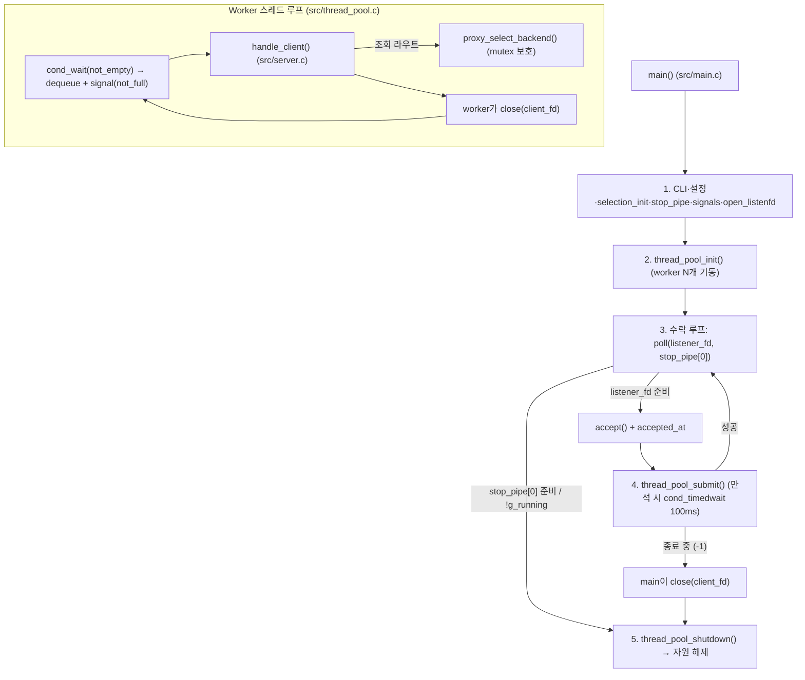

# Iteration 5 동시성 설계 결정 (C안: Blocking 스레드 풀)

상태: 구현 및 검증 완료. 이 문서는 [iteration-5-requirements.md](iteration-5-requirements.md)의 요구사항을 만족하기 위한 **모듈 책임 경계, 자료구조·수명 설계, 트레이드오프와 근거**를 기록한다. 검증 기준은 [iteration-5-tests.md](iteration-5-tests.md)에 따른다.

---

## 기존 표면과 변경 영향 요약

| 모듈 | 역할 및 변경 방향 |
| --- | --- |
| [src/main.c](../../../src/main.c) | 선택적 3번째 인자 `[workers]`(기본 4, `1..64`) 파싱, `stop_pipe[2]` + `on_shutdown_signal()` `write()`, `poll({listener_fd, stop_pipe[0]})` 수락 루프, `thread_pool` 기동·제출·종료 및 `proxy_selection_state` 초기화·해제 조율 |
| [src/thread_pool.h](../../../src/thread_pool.h), [src/thread_pool.c](../../../src/thread_pool.c) | 고정 크기(`128`) 링 버퍼 작업 큐, `mutex`/`cond` 동기화(`CLOCK_MONOTONIC` `pthread_cond_timedwait`), worker 스레드 풀 생성·실행·종료 및 잔여 FD 정리 |
| [src/socket_io.h](../../../src/socket_io.h), [src/socket_io.c](../../../src/socket_io.c) | `struct cancel_signal { const atomic_int *running; int stop_fd; }` 도입, `wait_socket_ready()`로 `poll()` 타임아웃/취소 감시 일원화, `socket_configure_timeouts()`(연결당 1회 5초 안전망), POSIX `writev()` 기반 `send_allv_with_deadline()` 추가 |
| [src/proxy.h](../../../src/proxy.h), [src/proxy.c](../../../src/proxy.c), [src/proxy_internal.h](../../../src/proxy_internal.h), [src/proxy_transfer.c](../../../src/proxy_transfer.c), [src/proxy_io.c](../../../src/proxy_io.c), [src/proxy_headers.c](../../../src/proxy_headers.c) | `struct proxy_selection_state` mutex 보호·수명 함수 추가, `proxy_prepare_response()`/`stream->cancel` 취소 전파, `connect_backend()` 1회 타임아웃 설정, `forward_request_to_backend()` `{header, body}` 단일 `writev()` 전송 |
| [src/server.h](../../../src/server.h), [src/server.c](../../../src/server.c) | `handle_client()`가 `const struct cancel_signal *`를 받아 수락 소켓 1회 타임아웃 설정 후 `io_context`·프록시로 전달, `send_chunked_body()` 청크/종료 프레임 단일 `writev()` 전송, `client_fd` 닫기를 호출자(worker) 책임으로 갱신 |
| [src/handlers/cgi.c](../../../src/handlers/cgi.c) | `spawn_cgi_process()`에서 `pipe(pipefd)` 직후 `set_close_on_exec()` 호출로 멀티스레드 `fork()` 간 파이프 FD 상속 차단, `wait_readable()`에 `cancel_signal`(`stop_fd`) 전달해 느린 CGI 중 `SIGTERM` 즉시 종료 지원 |
| [Makefile](../../../Makefile) | `CFLAGS`에 `-pthread` 추가, `thread_pool` 소스 및 `test_thread_pool`, `verify_iter5.py` 타겟 추가 |
| [src/http.c](../../../src/http.c), [src/router.c](../../../src/router.c), [src/proxy_body.c](../../../src/proxy_body.c), `src/handlers/{basic,static,greet}.c` | **변경 없음** (요청별 지역/동적 상태만 사용하므로 기존 순차 처리 흐름 재사용) |

---

## 주요 설계 결정 및 근거

### D1. C안 구조 경계 (수락 담당 + 제한된 작업 큐 + 고정 Blocking 스레드 풀)

- **결정**: 연결마다 스레드를 생성하지 않고, 시작 시 고정 개수(`1..64`, 기본 `4`)의 worker 스레드를 미리 생성한다. 수락 담당(`main`)과 요청 처리(`worker`)를 분리하고, 그 사이에 사용자 공간 작업 큐를 둔다.
- **근거**:
  - 기존 `handle_client()` 및 정적·동적·CGI·Reverse Proxy 코드를 거의 수정 없이 재사용할 수 있다.
  - 작업 큐는 HTTP·프록시 내용을 전혀 알지 못하고 `{ int client_fd; struct timespec accepted_at; }` 전달과 수명 관리만 맡아 책임 경계가 단순하다.
  - 한 worker가 I/O를 기다리는 동안 다른 worker가 정상 요청을 처리하므로 순차 서버의 Head-of-Line 블로킹이 완화되며, 동시에 모든 worker가 점유되면 큐에 대기가 쌓이는 C안의 구조적 한계를 A·B(`epoll`)와 공정하게 비교할 수 있다.

### D2. 큐 상한(`128`) 및 만석 시 순수 배압 정책 (방안 1-A + `pthread_cond_timedwait`)

- **결정**: 작업 큐 용량은 `128`(`LISTEN_BACKLOG`와 동일)로 고정한다. 큐가 가득 차면 수락 스레드는 `not_full` 조건 변수에서 빈 자리가 날 때까지 대기하되, `CLOCK_MONOTONIC` 속성으로 설정한 `pthread_cond_timedwait`(최대 `100ms` 간격)를 사용해 대기 중에도 종료 여부를 재확인한다.
- **트레이드오프 및 근거**:
  - **커널 대기와의 관계**: 사용자 공간 큐 상한을 제한하더라도 worker 처리 한계를 넘으면 대기가 커널 `listen` 백로그로 이동할 뿐 전체 대기 자체가 사라지지는 않는다. 다만 상한을 두어 아직 처리하지 못할 연결의 FD와 `accepted_at` 타이머를 사용자 공간에 과도하게 미리 쌓지 않는다.
  - **배압 선택 이유**: 비교 실험에서 일시적 버스트 연결을 즉시 `503`으로 떨어뜨리기보다 처리 완료·지연 분포를 관측하기 위해 순수 배압을 택한다.
  - **데드락 방지**: 시그널 핸들러는 `pthread_cond_broadcast()`를 부를 수 없으므로(async-signal-safe 위반), 큐가 꽉 찬 순간 종료 시그널이 와도 `pthread_cond_timedwait(100ms)`가 `ETIMEDOUT`으로 스스로 깨어나 종료 플래그를 확인하게 한다. 평소에는 worker가 작업을 꺼내며 `pthread_cond_signal(&not_full)`을 보내므로 `100ms`를 기다리지 않고 즉시 깨어난다.

### D3. `self-pipe` + `poll()` 기반 종료 시그널 전달

- **결정**: `main()` 시작 시 `stop_pipe[2]`를 생성해 읽기·쓰기 FD 모두 `set_close_on_exec()` 및 `O_NONBLOCK`을 설정한다. `on_shutdown_signal()`은 lock-free `atomic_int`(`_Static_assert(ATOMIC_INT_LOCK_FREE == 2)`)인 `g_running = 0` 설정 후 `errno`를 보존하며 `write(g_stop_write_fd, "x", 1)`을 수행한다(멀티스레드 TSan 데이터 경쟁 제거). `main()`의 수락 루프는 `accept()` 직전 `poll()`로 `{listener_fd, stop_pipe[0]}` 고정 2개 FD만 감시한다.
- **트레이드오프 및 근거**:
  - 멀티스레드에서 `SIGINT`/`SIGTERM`은 worker 스레드로 전달될 수 있어, 단순 `accept()`만 호출하면 `EINTR`을 놓치고 [src/socket_io.c](../../../src/socket_io.c)의 `SO_RCVTIMEO`(5초)까지 대기하게 된다(기존 `C13` `0.75초`·`Iter 1/3` `3초` 종료 기준 위반 위험).
  - 대안인 `pthread_sigmask` 분리 방식은 worker의 차단 마스크가 `fork()`된 CGI 자식에 상속되어 [src/handlers/cgi.c](../../../src/handlers/cgi.c)에서 `sigprocmask` 복구가 추가로 필요하고 `accept()` 직전 찰나의 경합도 남는다.
  - `self-pipe + poll()`은 시그널 마스크를 건드리지 않고, 어느 스레드가 시그널을 받든(또는 `poll()` 진입 직전 도착하든) 파이프에 남은 1바이트가 `main()`을 `0.00s`에 깨운다. 감시 대상이 항상 FD 2개뿐이므로 O(1)이며, 요청 I/O용 이벤트 루프가 아니다.
  - **워커 I/O 즉시 취소 (`struct cancel_signal`)**: `main()`만 깨어나면 워커가 `recv(backend_fd)` 등에서 1~5초 타임아웃까지 대기해 `C13`(`0.75초` 종료 기준)을 넘길 수 있다. 따라서 `running`과 `stop_pipe[0]`을 `struct cancel_signal` 하나로 묶어 `handle_client()` → `struct io_context.cancel` 및 `proxy_stream.cancel`로 전달해 `socket_io.c`와 `proxy_io.c`도 `stop_pipe[0]`을 함께 감시하도록 했다(`cancel == NULL`이면 취소 감시 생략).
  - **전달 경계 규칙 (`cancel_signal` vs `io_context`)**: 모듈 경계 및 요청·스트림 전체 수명(`handle_client`, `proxy_prepare_response`, `proxy_stream`)은 `const struct cancel_signal *`만 들고 다니며 `cancel_signal_is_running()`으로 확인하고, 실제 소켓 `recv`/`send` 루프 경계(`receive_with_deadline`, `send_all_with_deadline` 및 `server.c` 정적 I/O 헬퍼, `proxy_io.c`/`proxy_headers.c` 호출 직전)에서만 `{ cancel, deadline }`을 묶은 `const struct io_context *`와 `server_is_running()`을 사용한다(project `AGENTS.md`에도 동일 규칙 기록).

### D4. `client_fd` 소유권 이전과 `accepted_at` 타임아웃 기준

- **결정**: `accept()` 직후 `clock_gettime(CLOCK_MONOTONIC, &accepted_at)`을 찍어 `client_fd`와 함께 큐에 넣는다. `thread_pool_submit()` 성공 시 FD 소유권은 `main()`에서 큐로, worker가 dequeue하면 worker로 넘어가 `handle_client()` 종료 직후 worker가 `close(client_fd)`를 호출한다. 종료 중 `submit()`이 실패하면 `main()`이 즉시 닫고, 종료 시 큐에 남아 미시작된 FD는 `thread_pool_shutdown()`이 모두 닫는다.
- **트레이드오프 및 근거**:
  - `accepted_at`을 유지하면 큐에서 오래 대기한 연결도 기존 `HEADER_DEADLINE_SECONDS`(7초) 계약 안에서 `408`로 빠르게 정리된다. 반대로 과부하로 7초 이상 대기한 정상 요청이 `408`로 거절될 수 있으나, 이는 일관된 요청 수명 계약 유지 차원에서 감수한다.
  - 이미 worker가 처리 중인 연결은 `g_running = 0` 확인 후 각자 정리를 마칠 때까지 `pthread_join()`으로 대기해 자원 누수와 이중 `close`를 막는다.

### D5. `struct proxy_selection_state`의 `pthread_mutex_t` 동기화

- **결정**: [src/proxy.h](../../../src/proxy.h)의 `struct proxy_selection_state`에 `pthread_mutex_t`를 포함하고, 초기화/해제 함수를 추가한다. [src/proxy.c](../../../src/proxy.c)의 `proxy_select_backend()`는 `PROXY_ROUTE_QUERY`에서 `next_query_backend`를 읽고 `(selected_index + 1) % 2`로 갱신하는 임계 구역만 lock/unlock으로 보호한다.
- **트레이드오프 및 근거**:
  - `atomic` 대안(`fetch_add` 또는 CAS 루프)도 가능하나, 현재 코드의 `% 2` 순번 갱신 로직을 그대로 보존하고 추후 상태 필드가 늘어나더라도 임계 구역 단위로 확장할 수 있어 `mutex`를 선택했다.
  - 동기화 도구를 작업 큐와 동일한 `pthread_mutex_t`로 통일하며, lock 구간은 정수 연산 2줄(수 ns)뿐이고 네트워크 I/O 전에 즉시 해제하므로 병목이 되지 않는다.
  - 선택 정책 내부에서 동기화를 완결하므로 `handle_client()`와 worker는 동기화 방식을 알지 못한다.

### D6. `src/handlers/cgi.c` 파이프 `FD_CLOEXEC` 보완

- **결정**: `spawn_cgi_process()`에서 `pipe(pipefd)` 직후 `set_close_on_exec(pipefd[0])`와 `set_close_on_exec(pipefd[1])`를 호출한다.
- **근거**: 단일 스레드에서는 `pipe()`와 `fork()`가 순차 실행돼 문제가 없었으나, 멀티스레드에서는 스레드 A가 `pipe()`를 연 직후 스레드 B가 `fork()`를 실행하면 스레드 B의 CGI 자식이 스레드 A의 `pipefd[1]`을 상속받아 EOF가 지연될 수 있다. `dup2(pipefd[1], STDOUT_FILENO)`로 새로 복제된 `STDOUT_FILENO`에는 `FD_CLOEXEC`가 붙지 않으므로 자식 프로세스의 표준 출력 동작에는 영향이 없다.

---

## 탑다운 Function Flow (Structure)

### 1. 전체 흐름 (Level 0 → Level 1)



### 2. 계층별 하위 역할 구조 (Level 2 → Level 3)

#### A. 진입점 조율 ([src/main.c](../../../src/main.c))
```text
main()
├─ parse_worker_count()       # 선택적 3번째 인자 검증 (1..64, 기본 4)
├─ setup_stop_pipe()          # pipe() + O_NONBLOCK + set_close_on_exec()
├─ setup_signals()            # SIGINT/SIGTERM → on_shutdown_signal(g_running=0 + pipe write)
├─ accept_loop()              # poll({listener_fd, stop_pipe[0]}) → accept() → thread_pool_submit()
└─ cleanup                    # thread_pool_shutdown() → proxy_selection_destroy() → close FDs
```

#### B. 작업 큐 및 워커 풀 ([src/thread_pool.c](../../../src/thread_pool.c))
```text
thread_pool_init()            # CLOCK_MONOTONIC condattr 설정, 링 버퍼 할당, worker 스레드 생성
thread_pool_submit()          # lock → 만석 시 cond_timedwait(100ms) & 종료 확인 → push + signal(not_empty)
worker_main()                 # lock → 공백 시 cond_wait(not_empty) → pop + signal(not_full) → unlock
                              # → handle_client() → close(client_fd)
thread_pool_shutdown()        # shutting_down=1 + broadcast(not_empty, not_full) → join → 잔여 큐 FD close
```

#### C. 조회 순번 보호 및 CGI 안전 보완 ([src/proxy.c](../../../src/proxy.c), [src/handlers/cgi.c](../../../src/handlers/cgi.c))
```text
proxy_selection_init() / proxy_selection_destroy()
proxy_select_backend()        # PROXY_ROUTE_QUERY: lock → index % 2 읽기·갱신 → unlock

spawn_cgi_process()           # pipe(pipefd) → set_close_on_exec(pipefd[0]/[1]) → fork() → dup2() → execve()
```
